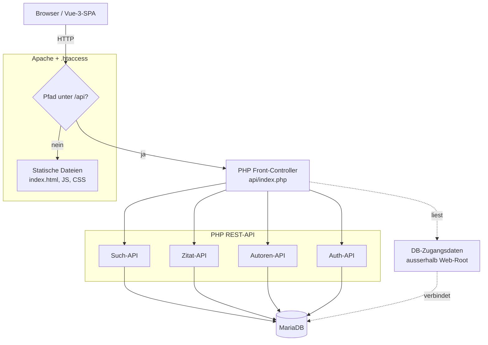
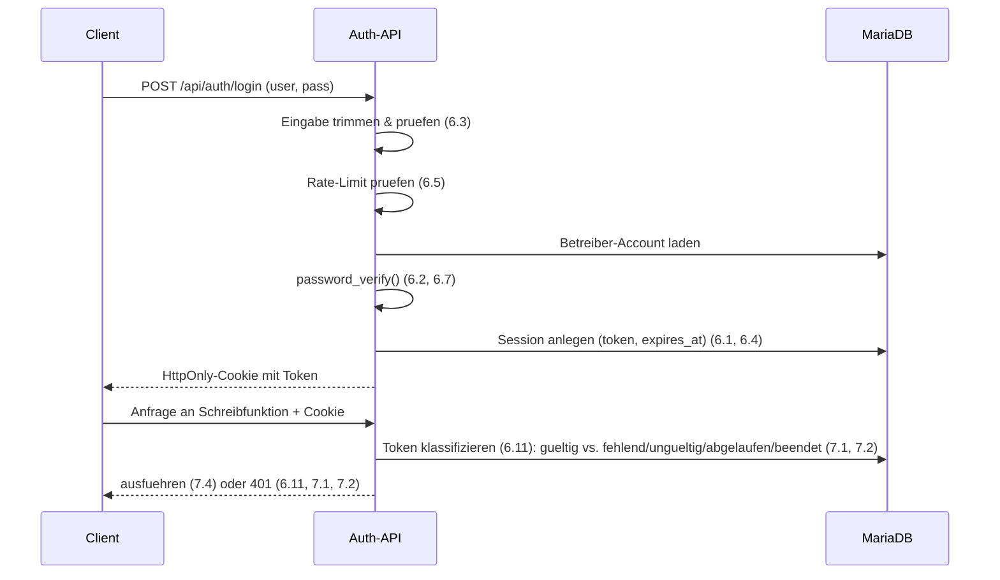
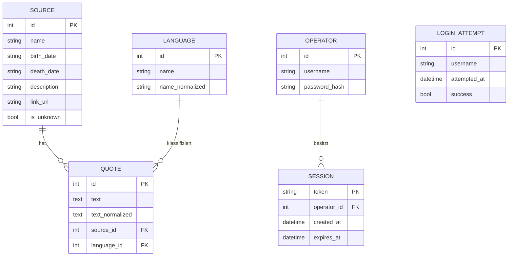

# Design Document: citations-management

## Overview

Das Zitate-System überführt eine bisher papierbasierte Zitate-Sammlung in eine
Web-Anwendung. Es besteht aus drei Schichten:

1. **Frontend** – eine statisch gebaute Vue-3-Anwendung (SPA), mehrsprachig
   (Deutsch/Englisch), ausgeliefert als reine statische Dateien ohne Node.js-Laufzeit
   auf dem Server. Besonderheiten der Oberfläche:
   - **Oberflächensprache (Anf. 14):** Die Texte liegen in DE und EN vor (14.1); ein
     Sprachwechsel ändert nur Oberflächentexte, nicht die Sprache einzelner Zitate
     (14.2, 14.4). Beim erstmaligen Aufruf ohne gespeicherte Oberflächensprache wählt
     das Frontend die von den Browser-Spracheinstellungen bevorzugte bereitgestellte
     Sprache (DE oder EN) und fällt auf Deutsch zurück, falls keine bereitgestellte
     Sprache bevorzugt wird (14.3).
   - **Längenbegrenzte Eingabefelder (Anf. 14.5, 14.6):** In allen Feldern mit
     Längenbeschränkung (Sucheingabe 200, Zitattext 5000, Quellenname 200, optionale
     Quellenfelder 500, Link-URL 2000, Sprachbezeichnung 100 Zeichen) begrenzt das
     Frontend die Eingabe auf die jeweilige Maximallänge und zeigt die aktuelle
     Zeichenanzahl sowie die zulässige Maximallänge sichtbar an. Diese
     Client-Begrenzung ergänzt die serverseitige Durchsetzung (`INPUT_TOO_LONG`,
     `QUERY_TOO_LONG`), ersetzt sie aber nicht.
   - **Lösch-Entscheidungs-Dialog (Anf. 11.6):** Wird das Löschen einer Quelle mit
     mindestens einem zugeordneten Zitat angehalten (`SOURCE_HAS_QUOTES`), zeigt das
     Frontend genau die beiden Varianten Umhängen und Löschabbruch an und übermittelt
     die gewählte Variante als `strategy` an die Autoren-API.
2. **REST-API** – eine schlanke PHP-Anwendung unter dem Pfad `/api`, aufgeteilt in
   Such-API, Zitat-API, Autoren-API und Auth-API.
3. **Datenbank** – MariaDB, erreicht über PDO mit vorbereiteten Anweisungen.

Betrieb erfolgt auf IONOS Webhosting Pro (Apache) unter einer Subdomain von
`mhitzelberger.de`. Routing und Auslieferung werden über `.htaccess` gesteuert:
Pfade unter `/api` beantwortet die PHP-REST-API, alle übrigen Pfade liefern das
statische Frontend aus (SPA-Fallback auf `index.html`).

Dieses Dokument leitet seine Entwurfsentscheidungen direkt aus den Akzeptanzkriterien
in `requirements.md` ab. Jede Entscheidung mit Relevanz für Korrektheit wird in den
Correctness Properties auf das jeweilige Kriterium zurückgeführt.

### Entwurfsleitende Rechercheergebnisse

- **Passwort-Hashing (Anf. 6.7):** PHP-Standardfunktionen `password_hash()` mit
  `PASSWORD_DEFAULT` und `password_verify()`. Keine Eigenimplementierung von
  Kryptografie, kein Drittanbieter-Paket nötig. Der Algorithmus (aktuell bcrypt)
  wird von PHP verwaltet und ist zukunftssicher über `PASSWORD_DEFAULT`.
- **Diakritika- und Case-insensitive Matching (Anf. 2.6):** Reines Verlassen auf
  MariaDB-Collations (`utf8mb4_unicode_ci`) deckt zwar Filterung ab, erlaubt aber
  keine abgestufte Relevanzwertung (Wortgrenze vs. Wortanfang vs. Teiltreffer).
  Daher wird ein **normalisierter Vergleich in der Anwendungsschicht** verwendet:
  Zitattext und Quellenname werden vor dem Scoring in eine Normalform (kleingeschrieben,
  diakritische Zeichen entfernt) überführt. Die DB liefert über einen vorgefilterten
  `LIKE`-Kandidatensatz, das endgültige Scoring erfolgt deterministisch in PHP.
- **Statisches Vue + PHP auf IONOS:** Apache liefert die statischen Build-Artefakte
  aus; `.htaccess` routet `/api/*` auf einen PHP-Front-Controller und fällt für
  Nicht-API-Pfade auf `index.html` zurück. Dies ist mit Shared Hosting ohne
  Node.js-Laufzeit vereinbar (Anf. 16.1).
- **Sichere Credential-Ablage (Anf. 15):** Zugangsdaten liegen in einer PHP-Datei
  **oberhalb des Web-Roots** (bzw. aus Umgebungsvariablen). Sie werden nicht im
  Repository versioniert; eine `.gitignore` schließt sie aus, und keine
  Credential-Datei liegt unter einem öffentlich erreichbaren Pfad.

## Architecture

### Komponentenübersicht

### Request-Routing (Anf. 16.3, 16.4)

- `.htaccess` prüft jede Anfrage: Beginnt der Pfad mit `/api`, wird sie an
  `api/index.php` (Front-Controller) weitergeleitet.
- Alle anderen Pfade werden auf statische Dateien abgebildet; existiert die Datei
  nicht, greift der SPA-Fallback auf `index.html`, damit clientseitiges Routing
  (Suchseite, Zitat-Einzelansicht, Quellen-Einzelansicht, Admin) funktioniert.

### Schichtenschnitt

Die PHP-API trennt bewusst **reine Logik** (Tokenisierung, Normalisierung,
Relevanz-Scoring, Validierung, Pagination-Berechnung) von **I/O** (DB-Zugriff,
HTTP). Die reine Logik ist seiteneffektfrei und damit gezielt property-basiert
testbar; die I/O-Schicht wird über Beispiel- und Integrationstests abgedeckt.

### Authentifizierungsfluss (Anf. 6, 7)

## Components and Interfaces

Alle Endpunkte liegen unter `/api`. Antworten sind JSON. Fehlerantworten enthalten
einen maschinenlesbaren `error`-Code und eine menschenlesbare Meldung. Statuscodes:
`200` ok, `201` angelegt, `400` Validierungsfehler, `401` nicht autorisiert,
`404` nicht gefunden, `409` Konflikt, `429` Rate-Limit, `500` allgemeiner Fehler.

### Such-API

**`GET /api/search`** (öffentlich, Anf. 1, 2)
- Query-Parameter: `q` (Sucheingabe, 1–200 Zeichen), `languages` (optionale,
  kommaseparierte Sprach-IDs), `page` (Standard 1), `pageSize` (1–100, Standard 20),
  optional `sourceId` (schränkt auf Zitate einer Quelle ein, für Anf. 5.3).
- Verhalten:
  - Zerlegt die Sucheingabe `q` anhand von Leerzeichen in einen oder mehrere
    **Suchbegriffe** (einzelne Teilwörter); leere/nur-Whitespace-Sucheingabe → `400`
    `MISSING_QUERY` ohne Suchausführung (1.9).
  - Lehnt eine Sucheingabe mit mehr als 200 Zeichen vor der Zerlegung mit `400`
    `QUERY_TOO_LONG` ab, ohne eine Suche auszuführen (1.13).
  - Durchsucht nur Zitattext und Quellenname (1.3), schließt Geburts-/Sterbedatum
    und Kurzbeschreibung aus (1.4).
  - ODER-Verknüpfung über die Suchbegriffe: Ein Zitat ist ein Treffer, wenn
    Zitattext ODER Quellenname mindestens einen Suchbegriff als Teiltreffer ohne
    Beachtung der Groß-/Kleinschreibung enthält (1.1, 1.2); optionaler Sprachfilter
    (1.10, 1.11, 1.12).
  - Berechnet je Zitat genau einen Relevanzwert und sortiert absteigend (1.5, 2.1);
    stabile, wiederholbare Tie-Break-Reihenfolge über Zitat-ID (2.7).
  - Pagination (1.6); keine Treffer → leere Liste, `total: 0` (1.7);
    Seite über letzter Seite → leere Liste, unveränderte `total` (1.8).
- Antwort: `{ items: [{ id, text, languageId, languageName, source: { id, name } }], total, page, pageSize }`.

**`GET /api/random`** (öffentlich, Anf. 3)
- Liefert genau ein zufälliges Zitat mit Text, Sprache und Quelle (3.1);
  gleichverteilt wählbar, nicht datenunabhängig fest (3.2); keine Zitate → `404`
  `NO_QUOTES` (3.3).

### Zitat-API

**`GET /api/quotes/{id}`** (öffentlich, Anf. 4)
- Liefert `{ id, text, languageId, languageName, source: { id, name, linkUrl } }` (4.1).
- `linkUrl` wird fürs Frontend zur Darstellung als Verweis genutzt (4.3/4.4);
  nicht existierend → `404` `NOT_FOUND` (4.5).

**`POST /api/quotes`** (geschützt, Anf. 7, 8)
- Body: `{ text, sourceId?, languageId }`.
- `text` 1–5000 Zeichen nach Trim; fehlend/leer → `400` `MISSING_TEXT` (8.2); nach Trim
  mehr als 5000 Zeichen → `400` `INPUT_TOO_LONG` ohne Anlegen (8.6).
- `sourceId` muss vorhandene Quelle referenzieren; fehlt `sourceId`, wird die
  Unbekannt-Quelle zugeordnet (13.3); ungültige ID → `400` `INVALID_SOURCE` (8.3).
- `languageId` muss vorhandene Sprache sein; fehlend/ungültig → `400`
  `INVALID_LANGUAGE` (8.4). Es wird keine neue Quelle angelegt (8.5).
- Erfolg → `201` mit `{ id }` (8.1).

**`PUT /api/quotes/{id}`** (geschützt, Anf. 9)
- Body wie beim Anlegen. Gültig → speichert geänderte Werte (9.1).
- Ungültiger Text → `400`, Zitat unverändert (9.2); Text nach Trim über 5000 Zeichen →
  `400` `INPUT_TOO_LONG`, Zitat unverändert (9.6); ungültige Quelle/Sprache →
  `400`, Zitat unverändert (9.3); nicht existierend → `404` (9.5).

**`DELETE /api/quotes/{id}`** (geschützt, Anf. 9)
- Vorhanden → entfernt und bestätigt (9.4); nicht vorhanden → `404` (9.5).

### Autoren-API

**`GET /api/sources/{id}`** (öffentlich, Anf. 5)
- Liefert `{ id, name, birthDate, deathDate, description, linkUrl }`; nicht gesetzte
  optionale Felder als leer/`null` (5.1, 5.2); nicht existierend → `404` (5.4).
- Das Frontend stellt den Verweis auf die quellengefilterte Suchseite bereit (5.3),
  die technisch über `GET /api/search?sourceId=...` bedient wird.

**`POST /api/sources`** (geschützt, Anf. 10, 13)
- Body: `{ name, birthDate?, deathDate?, description?, linkUrl? }`.
- `name` 1–200 Zeichen nach Trim; fehlend/leer → `400` `MISSING_NAME` (10.2); nach Trim
  über 200 Zeichen → `400` `INPUT_TOO_LONG` ohne Änderung (10.7).
- Optionale Freitextfelder je 0–500 Zeichen (10.3); `linkUrl` 0–2000 Zeichen und,
  falls gesetzt, Präfix `http://` oder `https://` (10.4), sonst `400`
  `INVALID_LINK_URL` (10.5). Überschreitet eines der optionalen Freitextfelder 500
  Zeichen oder die Link-URL 2000 Zeichen → `400` `INPUT_TOO_LONG` ohne Änderung (10.7).
- Name "unbekannt" (case-insensitive) bei bereits existierender Unbekannt-Quelle →
  `409` `UNKNOWN_SOURCE_RESERVED` (13.2).
- Erfolg → `201` mit `{ id }` (10.1).

**`PUT /api/sources/{id}`** (geschützt, Anf. 10)
- Gültige Werte → speichern (10.6); Validierung wie beim Anlegen (10.2, 10.5, 10.7).

**`DELETE /api/sources/{id}`** (geschützt, Anf. 11, 13)
- Quelle ohne zugeordnete Zitate → entfernen und bestätigen (11.1).
- Quelle mit ≥ 1 Zitat ohne Strategie-Angabe → `409` `SOURCE_HAS_QUOTES`,
  Vorgang angehalten, nichts geändert; fordert Entscheidung zwischen genau
  `reassign` und `cancel` an (11.2). Das Frontend zeigt dazu genau die zwei Varianten
  Umhängen und Löschabbruch an und übermittelt die Wahl als `strategy` (11.6).
- `?strategy=reassign` → alle Zitate der Unbekannt-Quelle zuordnen, dann Quelle
  entfernen (11.3).
- `?strategy=cancel` → Vorgang beenden, nichts ändern (11.4).
- Ziel ist die Unbekannt-Quelle → `400` `UNKNOWN_SOURCE_UNDELETABLE`, nichts
  geändert (11.5).

### Sprach-API (Anf. 12)

**`GET /api/languages`** (öffentlich, Anf. 12.7) – öffentliches Lese-Endpunkt ohne
Session, liefert die Liste aller vorhandenen Sprachen für Zuordnung/Filter (12.7).

**`POST /api/languages`** (geschützt)
- Body: `{ name }`. `name` 1–100 Zeichen nach Trim; fehlend/leer → `400`
  `MISSING_LANGUAGE_NAME` (12.4); nach Trim über 100 Zeichen → `400` `INPUT_TOO_LONG`
  ohne Anlegen (12.6). Bereits vorhanden (case-insensitive) → `409`
  `LANGUAGE_EXISTS` (12.5). Erfolg → gespeicherte Sprache, danach in verfügbarer
  Menge enthalten (12.3). Bestand ist dynamisch erweiterbar, nicht fest auf DE/EN
  begrenzt (12.2).

### Auth-API (Anf. 6, 7)

**`POST /api/auth/login`**
- Body: `{ username, password }`. Fehlend/nur Whitespace → `400`
  `MISSING_CREDENTIALS` ohne Passwortprüfung (6.3).
- Rate-Limit: 5 Fehlversuche pro Benutzerkennung in 15 Minuten → danach 15 Minuten
  Sperre, auch bei danach gültigen Daten → `429` `RATE_LIMITED` (6.5).
- Ungültige Daten → `401` `INVALID_CREDENTIALS`, generische Meldung (6.2). Die Prüfung
  erfolgt laufzeit-ausgeglichen: Auch bei unbekannter Benutzerkennung wird eine
  `password_verify()`-Vergleichsoperation gegen einen Dummy-Hash ausgeführt, damit sich
  die Fälle "unbekannte Benutzerkennung" und "bekannte Benutzerkennung mit falschem
  Passwort" nicht durch einen erkennbaren Zeitunterschied unterscheiden lassen (6.10).
- Gültige Daten → Session anlegen, HttpOnly-Cookie mit Token, Gültigkeitsdauer
  gemäß Konfiguration 1–168 h (Standard 24 h) (6.1, 6.4). Prüfung per
  `password_verify()` gegen gespeicherten Hash (6.7). Mehrere Accounts unterstützt,
  initial einer (6.8).

**`POST /api/auth/logout`** – Beendet Session; Token/Cookie gewährt keinen Zugang
mehr (6.6).

**Session-Guard (Middleware):** Jede schreibende Anfrage an Zitat-/Autoren-/Sprach-API
wird vor Ausführung geprüft. Das übermittelte Token wird gemäß Anforderung 6.11
klassifiziert: ein fehlendes, inhaltlich ungültiges, keiner Session zuordenbares,
gemäß 6.4 abgelaufenes oder durch Logout beendetes Token gilt als nicht
authentifiziert → `401` `UNAUTHORIZED`, keine Datenänderung (6.11, 7.1, 7.2); gültige
Session → ausführen (7.4). Die Nicht-autorisiert-Antwort ist unabhängig davon
identisch, ob die adressierte Ressource existiert, sodass keine Rückschlüsse auf den
Datenbestand möglich sind (7.6). Lesende Such- und Einzelansichten sind ohne Session
erreichbar (7.3).

### Konfiguration & Credentials (Anf. 15, 17)

- `config.php` (die **Einrichtungskonfiguration**) liegt **oberhalb des Web-Roots** und
  liefert DB-Host/-Adresse, -Port, -Name, -User, -Passwort, die konfigurierbare
  Session-Dauer sowie Benutzername und Passwort-Hash des initialen Betreiber-Accounts;
  alternativ aus Umgebungsvariablen (15.1, 17.1). Zugangsdaten sind nicht im
  Anwendungs-Quellcode fest eingebettet (15.1).
- Fehlt beim Start der Anfrageverarbeitung eines der Zugangsdaten-Felder Host/Adresse,
  Datenbankname, Benutzername oder Passwort → kein DB-Connect, Verarbeitung abgebrochen,
  generische `500`-Antwort ohne Zugangsdaten-Werte (15.2).
- Ist in der Einrichtungskonfiguration kein Port angegeben, wird der Standard-Port der
  MariaDB-Datenbank verwendet (15.3).
- Datei ist in `.gitignore`, nicht im Repository (15.4).
- Keine Credential-Datei liegt unter öffentlich erreichbarem Pfad; zusätzlich blockt
  `.htaccess` direkte Anfragen auf `*.php`-Config-Muster im API-Verzeichnis, sodass eine
  öffentliche URL weder Dateiinhalt noch Zugangsdaten-Werte liefert (15.5).
- Fehlt/unlesbar die Credential-Quelle → kein DB-Connect, generische `500`-Antwort
  ohne Offenlegung von Zugangsdaten und ohne Angaben zu Pfad oder Name der
  Zugangsdaten-Quelle (15.6).

### Initialer Betreiber-Account (Anf. 17)

Beim Start der Anfrageverarbeitung richtet das Zitate-System den initialen
Betreiber-Account aus der Einrichtungskonfiguration ein:

- Benutzername und Passwort-Hash werden ausschließlich aus der Einrichtungskonfiguration
  bezogen (17.1); es wird zu keinem Zeitpunkt ein Klartext-Passwort erwartet oder
  gespeichert (17.4).
- Existiert noch kein Betreiber-Account und enthält die Konfiguration Benutzername und
  Passwort-Hash, wird genau ein Account mit diesen Werten angelegt (17.2).
- Existiert bereits ein Betreiber-Account, wird kein weiterer aus der Konfiguration
  angelegt und der vorhandene unverändert gelassen (17.3) – der Vorgang ist damit
  idempotent.
- Fehlt oder ist Benutzername oder Passwort-Hash leer, während noch kein Account
  existiert, wird kein Account angelegt; ein Anmeldeversuch verweigert den Zugang
  (17.5, zusammen mit 6.2).
- Ein mitgeliefertes CLI-Werkzeug erzeugt aus einem Klartext-Passwort per
  `password_hash()` den für die Konfiguration benötigten Passwort-Hash, ohne das
  Klartext-Passwort dauerhaft abzulegen (17.6).

## Data Models

### Entity-Relationship-Übersicht

### Tabellen

**`source`** (Quelle, Anf. 5, 10, 11, 13)
- `id` INT PK AUTO_INCREMENT
- `name` VARCHAR(200) NOT NULL (1–200 nach Trim)
- `birth_date`, `death_date`, `description` VARCHAR(500) NULL (optional, 0–500)
- `link_url` VARCHAR(2000) NULL (optional, 0–2000; falls gesetzt `http(s)://`)
- `is_unknown` TINYINT(1) NOT NULL DEFAULT 0 – genau eine Zeile mit `1` (Unbekannt-Quelle)
- Invariante: genau eine Zeile mit `is_unknown = 1` und `name = 'unbekannt'` (13.1).

**`language`** (Sprache, Anf. 12)
- `id` INT PK AUTO_INCREMENT
- `name` VARCHAR(100) NOT NULL (1–100 nach Trim)
- `name_normalized` VARCHAR(100) NOT NULL, UNIQUE – kleingeschriebene Normalform
  zur case-insensitiven Eindeutigkeitsprüfung (12.5).

**`quote`** (Zitat, Anf. 1, 4, 8, 9, 12)
- `id` INT PK AUTO_INCREMENT
- `text` TEXT NOT NULL (1–5000 nach Trim)
- `text_normalized` TEXT NOT NULL – kleingeschrieben, diakritika-frei; dient
  Vorfilter und Scoring (2.6)
- `source_id` INT NOT NULL FK → `source.id` (genau eine Quelle)
- `language_id` INT NOT NULL FK → `language.id` (genau eine Sprache, 12.1)
- Löschen einer Quelle mit Zitaten nur über Reassign auf Unbekannt-Quelle (11.3);
  FK verhindert verwaiste Zitate.

**`operator`** (Betreiber, Anf. 6, 17)
- `id` INT PK; `username` VARCHAR UNIQUE; `password_hash` VARCHAR(255) – nur Hash (6.7).
- Mehrere Accounts möglich, initial einer (6.8). Der initiale Account wird einmalig aus
  der Einrichtungskonfiguration angelegt, solange noch kein Account existiert; ein
  bereits vorhandener Account bleibt unverändert (17.2, 17.3).

**`session`** (Anf. 6, 7)
- `token` CHAR(64) PK (Hex aus `random_bytes(32)`); `operator_id` FK;
  `created_at`, `expires_at` DATETIME. Gültig, solange `now < expires_at` und Zeile
  existiert; Logout löscht die Zeile (6.6). `expires_at = created_at + Session-Dauer`
  (6.4).

**`login_attempt`** (Anf. 6.5)
- Protokolliert Versuche je `username` mit Zeitstempel und Erfolg; dient dem
  Rate-Limit-Fenster (5 Fehlversuche / 15 min → 15 min Sperre).

### Abgeleitete / normalisierte Werte

- **Normalform** (für `text_normalized`, `name_normalized`, Suchwörter): Unicode-
  Dekomposition, Entfernen kombinierender diakritischer Zeichen, Kleinschreibung.
  Dieselbe Funktion wird auf gespeicherte Daten und auf die Sucheingabe (bzw. ihre
  einzelnen Suchbegriffe) angewandt, damit der Vergleich symmetrisch und
  diakritika-/case-insensitiv ist (2.6).
- **Relevanzwert**: rein berechnet aus normalisiertem Zitattext, normalisiertem
  Quellenname und den normalisierten Suchwörtern (siehe Correctness Properties).

## Correctness Properties

*Eine Property ist eine Eigenschaft oder ein Verhalten, das über alle gültigen
Ausführungen eines Systems hinweg gelten soll — im Kern eine formale Aussage darüber,
was das System tun soll. Properties bilden die Brücke zwischen menschenlesbaren
Spezifikationen und maschinell überprüfbaren Korrektheitsgarantien.*

Die folgenden Properties beziehen sich auf die seiteneffektfreie Logikschicht
(Normalisierung, Tokenisierung, Relevanz-Scoring, Validierung, Pagination,
Session-/Rate-Limit-Logik) sowie auf die zustandsverändernden Operationen mit
injizierbarem Datenspeicher (In-Memory-Repository im Test). I/O-nahe Kriterien
(DB-Zufall, HTTP-Routing, UI-Rendering, Credential-Ablage) werden gemäß Testing
Strategy über Beispiel-, Integrations- und Smoke-Tests abgedeckt.

### Property 1: Teiltreffer in Zitattext oder Quellenname werden gefunden

*Für jeden* Zitatbestand und jede gültige Sucheingabe gilt: Jedes Zitat, dessen
normalisierter Zitattext oder dessen normalisierter Quellenname mindestens einen
normalisierten Suchbegriff (Teilwort der Sucheingabe) als Teilzeichenkette enthält, ist
in der Gesamttreffermenge enthalten.

**Validates: Requirements 1.1, 1.2**

### Property 2: Treffer entstehen ausschließlich durch Zitattext oder Quellenname

*Für jedes* Zitat gilt: Kommt ein Suchwort ausschließlich in ausgeschlossenen
Feldern (Geburtsdatum, Sterbedatum, Kurzbeschreibung) und weder im Zitattext noch im
Quellennamen vor, so ist dieses Zitat nicht in der Treffermenge enthalten.

**Validates: Requirements 1.3, 1.4**

### Property 3: Ergebnisse sind absteigend nach Relevanzwert sortiert

*Für jede* Ergebnisliste einer Suche gilt: Für alle benachbarten Positionen i und i+1
ist der Relevanzwert an Position i größer oder gleich dem an Position i+1.

**Validates: Requirements 1.5, 2.1**

### Property 4: Pagination schneidet die sortierte Gesamtliste korrekt

*Für jede* sortierte Gesamttreffermenge sowie jede Seitennummer und Seitengröße
(mit Standard 1 bzw. 20 bei fehlenden Werten, Seitengröße eingeschränkt auf 1–100)
gilt: Die zurückgegebene Seite entspricht dem Ausschnitt der sortierten Gesamtliste
von Index (page-1)*pageSize bis page*pageSize, enthält höchstens pageSize Elemente,
und die gemeldete Gesamtanzahl entspricht der Länge der Gesamttreffermenge.

**Validates: Requirements 1.6**

### Property 5: Seiten jenseits der letzten Seite sind leer bei unveränderter Gesamtanzahl

*Für jede* Gesamttreffermenge und jede Seitennummer, die größer ist als die Anzahl
vorhandener Ergebnisseiten (ceil(total/pageSize)), gilt: Die zurückgegebene
Elementliste ist leer, und die gemeldete Gesamtanzahl entspricht unverändert der
Länge der Gesamttreffermenge.

**Validates: Requirements 1.8**

### Property 6: Leere oder reine Whitespace-Sucheingabe wird abgewiesen

*Für jede* Sucheingabe, die nach Entfernen von Leerzeichen leer ist (einschließlich
des leeren Strings und beliebiger reiner Whitespace-Zeichenketten), gilt: Die Such-API
antwortet mit dem Fehler MISSING_QUERY und führt keine Ergebnisberechnung durch.

**Validates: Requirements 1.9**

### Property 7: Sprachfilter schränkt Ergebnisse auf gewählte Sprachen ein

*Für jeden* Zitatbestand, jede gültige Sucheingabe und jeden nicht leeren
Sprachfilter gilt: Jedes Zitat in der Treffermenge besitzt eine zugeordnete Sprache,
die im Sprachfilter enthalten ist.

**Validates: Requirements 1.10**

### Property 8: Fehlender oder leerer Sprachfilter ist sprachneutral

*Für jeden* Zitatbestand und jede gültige Sucheingabe gilt: Die Treffermenge ohne
Sprachfilter (bzw. mit leerem Sprachfilter) ist identisch mit der Treffermenge, deren
Sprachfilter alle vorhandenen Sprachen umfasst.

**Validates: Requirements 1.11**

### Property 9: Trefferart-Hierarchie beim Relevanz-Scoring

*Für jedes* Suchwort und jeweils sonst gleichartige Zitate gilt: Ein Zitat, in dem das
Suchwort als eigenständiges Wort vorkommt, erhält einen höheren Relevanzwert als eines,
in dem es nur am Wortanfang vorkommt; und dieses wiederum einen höheren Relevanzwert als
eines, in dem das Suchwort nur als Teiltreffer innerhalb eines Wortes (nicht am
Wortanfang) vorkommt.

**Validates: Requirements 2.2, 2.3**

### Property 10: Mehr getroffene Suchwörter erhöhen den Relevanzwert

*Für jede* mehrwortige Sucheingabe und je zwei sonst gleichartige Zitate gilt: Ein
Zitat mit Treffern zu einer echten Obermenge der Suchwörter erhält einen höheren
Relevanzwert als ein Zitat mit Treffern zu einer echten Teilmenge dieser Wörter.

**Validates: Requirements 2.4**

### Property 11: Treffer in Text und Quellenname fließen gemeinsam ein

*Für jedes* Zitat und jede Sucheingabe gilt: Der Relevanzwert eines Zitats mit einem
zusätzlichen Treffer im Quellennamen ist größer oder gleich dem Relevanzwert desselben
Zitats ohne diesen Quellennamen-Treffer, bei ansonsten unveränderten Textreffern.

**Validates: Requirements 2.5**

### Property 12: Scoring ist case- und diakritika-invariant

*Für jeden* Zitatbestand und jede Sucheingabe gilt: Ersetzt man in Zitattext,
Quellenname und Sucheingabe beliebige Zeichen durch Groß-/Kleinschreibungs- oder
Diakritika-Varianten (gleiche Normalform), bleiben die Treffermenge und die
zugehörigen Relevanzwerte unverändert.

**Validates: Requirements 2.6**

### Property 13: Wiederholbare, eindeutige Reihenfolge bei Relevanzgleichstand

*Für jeden* Zitatbestand und jede Sucheingabe gilt: Zwei Ausführungen derselben Suche
liefern dieselbe Reihenfolge; bei gleichem Relevanzwert sind die betroffenen Zitate
eindeutig und wiederholbar nach aufsteigender Zitat-ID geordnet.

**Validates: Requirements 2.7**

### Property 14: Zufallsauswahl bleibt im gültigen Bereich und ist vollständig erreichbar

*Für jeden* nicht leeren Zitatbestand der Größe n und jeden injizierten Zufallswert
gilt: Der ausgewählte Index liegt in [0, n); und für jeden Index aus [0, n) existiert
ein Zufallswert, der genau diesen Index auswählt (jedes Zitat ist grundsätzlich
wählbar).

**Validates: Requirements 3.2**

### Property 15: Generische, ununterscheidbare Fehlerantwort bei ungültigen Zugangsdaten

*Für jeden* Betreiber-Account gilt: Die Fehlerantwort bei falschem Benutzernamen und
die Fehlerantwort bei korrektem Benutzernamen mit falschem Passwort sind in Fehlercode
und Meldung identisch (INVALID_CREDENTIALS).

**Validates: Requirements 6.2**

### Property 16: Fehlende oder Whitespace-Zugangsdaten werden ohne Passwortprüfung abgewiesen

*Für jede* Kombination aus Benutzername und Passwort, bei der mindestens eines nach
Entfernen von Leerzeichen leer ist, gilt: Die Auth-API antwortet mit
MISSING_CREDENTIALS, ohne eine Passwortprüfung durchzuführen.

**Validates: Requirements 6.3**

### Property 17: Session-Gültigkeit folgt der konfigurierten Ablaufdauer

*Für jeden* Erstellungszeitpunkt, jede konfigurierte Dauer (auf [1, 168] Stunden
begrenzt, Standard 24) und jeden Prüfzeitpunkt gilt: Die Session ist genau dann
gültig, wenn der Prüfzeitpunkt vor (Erstellungszeitpunkt + Dauer) liegt.

**Validates: Requirements 6.1, 6.4**

### Property 18: Rate-Limit sperrt nach fünf Fehlversuchen für 15 Minuten

*Für jede* Folge von Login-Versuchen einer Benutzerkennung gilt: Treten innerhalb
eines 15-Minuten-Fensters fünf fehlgeschlagene Versuche auf, so werden weitere
Login-Versuche dieser Kennung für 15 Minuten ab dem fünften Fehlversuch abgelehnt —
auch bei danach gültigen Zugangsdaten.

**Validates: Requirements 6.5**

### Property 19: Logout macht die Session dauerhaft ungültig

*Für jede* zuvor gültige Session gilt: Nach einem Logout wird dieselbe Session als
ungültig behandelt und gewährt keinen Zugang mehr.

**Validates: Requirements 6.6**

### Property 20: Passwort-Hash-Round-Trip

*Für jedes* Passwort gilt: Die Verifikation des aus dem Passwort erzeugten Hashes
gegen dasselbe Passwort ist erfolgreich, die Verifikation gegen ein abweichendes
Passwort schlägt fehl, und der gespeicherte Wert ist nicht mit dem Klartext-Passwort
identisch.

**Validates: Requirements 6.7**

### Property 21: Schreibzugriff ohne gültige Session verändert keine Daten

*Für jede* schreibende Operation der Zitat-, Autoren- oder Sprach-API und jedes gemäß
Anforderung 6.11 nicht authentifizierende Token (fehlend, inhaltlich ungültig, keiner
Session zuordenbar, gemäß 6.4 abgelaufen oder durch Logout beendet) gilt: Die Operation
wird mit UNAUTHORIZED abgelehnt, und der gesamte Datenstand bleibt unverändert.

**Validates: Requirements 6.11, 7.1, 7.2**

### Property 22: Lesende Endpunkte sind ohne Session erreichbar

*Für jeden* lesenden Endpunkt (Suche, Zufallszitat, Zitat- und Quellen-Einzelansicht,
Sprachliste über `GET /api/languages`) gilt: Eine Anfrage ohne Session wird nicht mit
UNAUTHORIZED abgelehnt; insbesondere ist die Sprachliste öffentlich ohne Session
abrufbar.

**Validates: Requirements 7.3, 12.7**

### Property 23: Zitat-Anlegen-Round-Trip

*Für jede* gültige Eingabe (getrimmter Text 1–5000 Zeichen, vorhandene Quelle,
vorhandene Sprache) gilt: Nach dem Anlegen liefert das Lesen des zurückgegebenen
Zitats genau die angelegten Werte (getrimmter Text, Quelle, Sprache).

**Validates: Requirements 8.1**

### Property 24: Ungültiger Zitattext verhindert jede Zustandsänderung

*Für jeden* Zitattext, der nach Trim leer ist, gilt sowohl beim Anlegen als auch beim
Bearbeiten: Die Operation wird mit MISSING_TEXT abgewiesen; beim Anlegen entsteht kein
neues Zitat, beim Bearbeiten bleibt das bestehende Zitat vollständig unverändert.

**Validates: Requirements 8.2, 9.2**

### Property 25: Ungültige Quelle oder Sprache verhindert Anlegen bzw. Änderung

*Für jede* nicht existierende Quellen- oder Sprachkennung gilt sowohl beim Anlegen als
auch beim Bearbeiten eines Zitats: Die Operation wird mit INVALID_SOURCE bzw.
INVALID_LANGUAGE abgewiesen; beim Anlegen entsteht kein Zitat, beim Bearbeiten bleibt
das bestehende Zitat unverändert.

**Validates: Requirements 8.3, 8.4, 9.3**

### Property 26: Zitat-Anlegen erzeugt keine neue Quelle

*Für jede* Anlege-Operation eines Zitats gilt: Die Menge der vorhandenen Quellen ist
vor und nach der Operation identisch.

**Validates: Requirements 8.5**

### Property 27: Zitat-Bearbeiten-Round-Trip

*Für jedes* vorhandene Zitat und jede gültige Eingabe gilt: Nach dem Bearbeiten liefert
das Lesen des Zitats genau die geänderten Werte.

**Validates: Requirements 9.1**

### Property 28: Zitat-Löschen entfernt genau das Zitat

*Für jedes* vorhandene Zitat gilt: Nach dem Löschen liefert das Lesen dieses Zitats
eine Nicht-gefunden-Antwort, und kein anderes Zitat wird verändert oder entfernt.

**Validates: Requirements 9.4**

### Property 29: Operationen auf nicht vorhandenen Zitaten ändern nichts

*Für jede* Kennung, die zu keinem vorhandenen Zitat gehört, gilt beim Bearbeiten und
beim Löschen: Die Zitat-API antwortet mit einer Nicht-gefunden-Antwort, und der gesamte
Datenstand bleibt unverändert.

**Validates: Requirements 9.5**

### Property 30: Quellen-Anlegen- und Bearbeiten-Round-Trip

*Für jede* gültige Eingabe (getrimmter Name 1–200 Zeichen, optionale Felder innerhalb
der Längengrenzen) gilt: Nach Anlegen bzw. Bearbeiten liefert das Lesen der Quelle
genau die gespeicherten Werte.

**Validates: Requirements 10.1, 10.6**

### Property 31: Ungültiger Quellenname verhindert jede Zustandsänderung

*Für jeden* Namen, der nach Trim leer ist, gilt beim Anlegen und Bearbeiten einer
Quelle: Die Operation wird mit MISSING_NAME abgewiesen, und es wird keine Quelle
angelegt oder verändert.

**Validates: Requirements 10.2**

### Property 32: Längengrenzen der optionalen Freitextfelder

*Für jeden* Wert der Felder Geburtsdatum, Sterbedatum und Kurzbeschreibung gilt: Werte
mit höchstens 500 Zeichen werden akzeptiert, Werte mit mehr als 500 Zeichen werden
abgewiesen, ohne die Quelle zu verändern.

**Validates: Requirements 10.3**

### Property 33: Validierung der Link-URL

*Für jeden* Link-URL-Wert gilt: Er ist genau dann gültig, wenn er leer ist oder
(höchstens 2000 Zeichen lang ist und mit "http://" oder "https://" beginnt).
Andernfalls wird die Operation mit INVALID_LINK_URL abgewiesen, ohne die Quelle zu
verändern.

**Validates: Requirements 10.4, 10.5**

### Property 34: Quelle ohne Zitate löschen entfernt die Quelle

*Für jede* Quelle ohne zugeordnete Zitate (ausgenommen die Unbekannt-Quelle) gilt: Nach
dem Löschen liefert das Lesen dieser Quelle eine Nicht-gefunden-Antwort.

**Validates: Requirements 11.1**

### Property 35: Löschen einer Quelle mit Zitaten ohne Strategie ändert nichts

*Für jede* Quelle mit mindestens einem zugeordneten Zitat gilt: Ein Löschversuch ohne
Strategie-Angabe wird mit SOURCE_HAS_QUOTES angehalten; die Quelle und alle ihr
zugeordneten Zitate bleiben vollständig unverändert.

**Validates: Requirements 11.2**

### Property 36: Umhängen bewahrt alle Zitate und entfernt die Quelle

*Für jede* Quelle mit zugeordneten Zitaten gilt beim Umhängen (reassign): Die Quelle
wird entfernt, die Gesamtzahl der Zitate bleibt unverändert, und jedes zuvor dieser
Quelle zugeordnete Zitat existiert weiterhin und ist nun der Unbekannt-Quelle
zugeordnet.

**Validates: Requirements 11.3**

### Property 37: Löschabbruch lässt alles unverändert

*Für jede* Quelle mit zugeordneten Zitaten gilt beim Löschabbruch (cancel): Die Quelle
und alle ihr zugeordneten Zitate bleiben vollständig unverändert.

**Validates: Requirements 11.4**

### Property 38: Die Unbekannt-Quelle ist unlöschbar

*Für jeden* Löschversuch der Unbekannt-Quelle (mit oder ohne Strategie) gilt: Die
Operation wird mit UNKNOWN_SOURCE_UNDELETABLE abgewiesen; die Unbekannt-Quelle und alle
ihr zugeordneten Zitate bleiben unverändert.

**Validates: Requirements 11.5**

### Property 39: Sprach-Anlegen-Round-Trip

*Für jede* gültige Sprachbezeichnung (getrimmt 1–100 Zeichen, normalisiert noch nicht
vorhanden) gilt: Nach dem Anlegen ist die Sprache in der Menge der verfügbaren Sprachen
enthalten.

**Validates: Requirements 12.3**

### Property 40: Ungültige Sprachbezeichnung wird abgewiesen

*Für jede* Bezeichnung, die nach Trim leer ist, gilt: Das Anlegen wird mit
MISSING_LANGUAGE_NAME abgewiesen, ohne die Sprachmenge zu verändern.

**Validates: Requirements 12.4**

### Property 41: Sprachen sind case-insensitiv eindeutig

*Für jede* Bezeichnung, deren Normalform (kleingeschrieben) bereits im Bestand
existiert, gilt: Das Anlegen wird mit LANGUAGE_EXISTS abgewiesen, ohne die Sprachmenge
zu verändern.

**Validates: Requirements 12.5**

### Property 42: Genau eine Unbekannt-Quelle bleibt erhalten

*Für jede* zulässige Folge von Anlege-, Bearbeitungs- und Löschoperationen auf Quellen
gilt: Nach der Ausführung existiert genau eine Quelle mit is_unknown = 1 und dem Namen
"unbekannt".

**Validates: Requirements 13.1**

### Property 43: Der Name "unbekannt" ist reserviert

*Für jede* Groß-/Kleinschreibungsvariante von "unbekannt" gilt: Der Versuch, damit eine
weitere Quelle anzulegen, wird mit UNKNOWN_SOURCE_RESERVED abgewiesen; es entsteht keine
zweite Unbekannt-Quelle.

**Validates: Requirements 13.2**

### Property 44: Zitat ohne Quellenauswahl erhält die Unbekannt-Quelle

*Für jede* Anlege-Operation eines Zitats ohne ausgewählte Quelle gilt: Das gespeicherte
Zitat ist der Unbekannt-Quelle zugeordnet.

**Validates: Requirements 13.3**

### Property 45: Überlange Sucheingabe wird abgewiesen

*Für jede* Sucheingabe mit mehr als 200 Zeichen gilt: Die Such-API antwortet mit dem
Fehler QUERY_TOO_LONG und führt keine Zerlegung in Suchbegriffe und keine
Ergebnisberechnung durch.

**Validates: Requirements 1.13**

### Property 46: Überlange längenbegrenzte Eingaben werden ohne Zustandsänderung abgewiesen

*Für jede* schreibende Operation mit einem längenbegrenzten Feld, dessen Wert nach Trim
die zulässige Maximallänge überschreitet — Zitattext über 5000 Zeichen (Anlegen und
Bearbeiten), Quellenname über 200 Zeichen, ein optionales Quellenfeld (Geburtsdatum,
Sterbedatum, Kurzbeschreibung) über 500 Zeichen, Link-URL über 2000 Zeichen oder
Sprachbezeichnung über 100 Zeichen — gilt: Die Operation wird mit INPUT_TOO_LONG
abgewiesen, und der gesamte Datenstand bleibt unverändert (kein neuer Datensatz, keine
Änderung eines bestehenden Datensatzes).

**Validates: Requirements 8.6, 9.6, 10.7, 12.6**

## Error Handling

### Fehlerantwort-Format

Alle Fehler werden einheitlich als JSON ausgeliefert:
`{ "error": "<CODE>", "message": "<menschenlesbare Meldung>" }`. Der `error`-Code ist
maschinenlesbar und stabil; die `message` dient der Anzeige im Frontend (lokalisierbar
anhand des Codes). Interne Details (Stacktraces, SQL, Zugangsdaten) werden niemals in
der Antwort offengelegt.

### Zuordnung Fehlercode → Statuscode

| Fehlercode | Status | Auslöser (Anforderung) |
|---|---|---|
| `MISSING_QUERY` | 400 | Leere/Whitespace-Sucheingabe (1.9) |
| `QUERY_TOO_LONG` | 400 | Sucheingabe über 200 Zeichen (1.13) |
| `MISSING_TEXT` | 400 | Zitattext leer/trim-leer (8.2, 9.2) |
| `INVALID_SOURCE` | 400 | Quelle fehlt/ungültig beim Zitat (8.3, 9.3) |
| `INVALID_LANGUAGE` | 400 | Sprache fehlt/ungültig beim Zitat (8.4, 9.3) |
| `MISSING_NAME` | 400 | Quellenname leer/trim-leer (10.2) |
| `INVALID_LINK_URL` | 400 | Link-URL ohne http(s)://-Präfix (10.5) |
| `INPUT_TOO_LONG` | 400 | Längenbegrenztes Feld über Maximallänge: Zitattext > 5000 (8.6, 9.6), Quellenname > 200, optionale Quellenfelder > 500, Link-URL > 2000 (10.7), Sprachbezeichnung > 100 (12.6) |
| `MISSING_LANGUAGE_NAME` | 400 | Sprachbezeichnung leer/trim-leer (12.4) |
| `UNKNOWN_SOURCE_UNDELETABLE` | 400 | Löschversuch der Unbekannt-Quelle (11.5) |
| `MISSING_CREDENTIALS` | 400 | Login-Daten fehlen/Whitespace (6.3) |
| `INVALID_CREDENTIALS` | 401 | Login-Daten ungültig, generisch (6.2) |
| `UNAUTHORIZED` | 401 | Schreibzugriff ohne authentifizierende Session gemäß Token-Klassifikation (6.11, 7.1, 7.2) |
| `NOT_FOUND` | 404 | Zitat/Quelle nicht vorhanden (4.5, 5.4, 9.5) |
| `NO_QUOTES` | 404 | Zufallszitat ohne Bestand (3.3) |
| `SOURCE_HAS_QUOTES` | 409 | Quelle mit Zitaten ohne Strategie (11.2) |
| `UNKNOWN_SOURCE_RESERVED` | 409 | Zweite Quelle "unbekannt" (13.2) |
| `LANGUAGE_EXISTS` | 409 | Sprache bereits vorhanden (12.5) |
| `RATE_LIMITED` | 429 | Login-Rate-Limit überschritten (6.5) |
| `INTERNAL_ERROR` | 500 | Fehlendes Zugangsdaten-Feld (15.2); fehlende/unlesbare Credential-Quelle (15.6); unerwarteter interner Fehler oder DB-Verbindungs-/Abfragefehler ohne Offenlegung und ohne Datenänderung (15.7) |

### Transaktionale Integrität

Schreibende Mehrschritt-Operationen laufen in DB-Transaktionen, sodass bei einem Fehler
kein Teilzustand persistiert wird. Dies stützt die Unveränderlichkeits-Properties (21,
24, 25, 29, 35, 37, 38, 46): Wird eine Operation abgewiesen, erfolgt ein Rollback, und
der Datenstand bleibt exakt erhalten. Das Umhängen beim Quellenlöschen (Property 36) führt
Zuordnungsänderung und Quellenlöschung in einer einzigen Transaktion aus.

### Validierungsreihenfolge

Die Session-Prüfung (Guard) läuft vor jeder inhaltlichen Validierung schreibender
Endpunkte (7.5), damit nicht autorisierte Anfragen keine Fachlogik auslösen. Danach
folgt die reine Eingabe-Validierung (Trim, Längen, Referenzen), erst dann der DB-Zugriff.
Die Login-Validierung prüft gemäß der in Anforderung 6.9 festgelegten Reihenfolge zuerst
Vollständigkeit (6.3), dann Rate-Limit (6.5), dann die Zugangsdaten (6.2).

### Fehlende Konfiguration / DB-Ausfall

Fehlt eines der Zugangsdaten-Felder Host/Adresse, Datenbankname, Benutzername oder
Passwort (15.2) oder fehlt bzw. ist die Credential-Quelle unlesbar (15.6), wird keine
DB-Verbindung aufgebaut; die API antwortet mit `INTERNAL_ERROR` (500) ohne Offenlegung
von Zugangsdaten sowie ohne Angaben zu Pfad oder Name der Zugangsdaten-Quelle. Tritt beim
Verarbeiten einer Anfrage ein unerwarteter interner Fehler oder ein
DB-Verbindungs- bzw. Abfragefehler auf, so wird er gefangen und ebenfalls als
generischer `INTERNAL_ERROR` beantwortet, der weder Zugangsdaten-Werte noch
SQL-Anweisungen noch Programmablaufspuren (Stacktraces) enthält; bereits gespeicherte
Daten werden dabei nicht verändert, da schreibende Operationen bei einem Fehler per
Transaktions-Rollback zurückgesetzt werden (15.7).

## Testing Strategy

Die Teststrategie ist zweigeteilt und ergänzt sich: **Property-basierte Tests** sichern
universelle Eigenschaften der reinen Logik- und Mutationsschicht über viele generierte
Eingaben ab; **Beispiel-, Integrations- und Smoke-Tests** decken konkrete Fälle,
I/O-Verhalten, Routing, UI und Betrieb ab.

### Property-basierte Tests (Backend-Logik)

- **Bibliothek:** Für die PHP-Logikschicht wird eine etablierte Property-Testing-
  Bibliothek genutzt (z. B. `giorgiosironi/eris` oder vergleichbar); Property-Testing
  wird nicht selbst implementiert.
- **Testarchitektur:** Die reine Logik (Normalisierung, Tokenisierung, Scoring,
  Validierung, Pagination, Session-Ablauf, Rate-Limit, Zufallsauswahl mit injiziertem
  RNG) und die Mutationsoperationen gegen ein **In-Memory-Repository** (Interface-
  identisch zum PDO-Repository) sind ohne echte DB testbar. Dadurch sind die
  Properties 1–46 kostengünstig über ≥ 100 Iterationen ausführbar.
- **Iterationen:** Jeder Property-Test läuft mit mindestens 100 generierten Fällen.
- **Tagging:** Jeder Property-Test trägt einen Kommentar im Format
  **Feature: citations-management, Property {Nummer}: {Property-Text}** und ist damit
  auf die jeweilige Property dieses Dokuments rückführbar.
- **Generatoren:** Zitat-, Quellen- und Sprach-Generatoren erzeugen gezielt Randfälle:
  Groß-/Kleinschreibung, diakritische Zeichen (z. B. „ä/a“, „é/e“), reine Whitespace-
  Strings, Grenzlängen (0, 1, 100, 200, 500, 2000, 5000 Zeichen), mehrwortige
  Sucheingaben sowie Wortgrenzen- vs. Wortanfang- vs. Infix-Treffer. Damit werden die
  Edge-Cases 1.7, 1.12, 3.3, 4.5, 5.4 implizit mit abgedeckt.

### Property-Abdeckung im Überblick

| Bereich | Properties |
|---|---|
| Suche & Filter | 1, 2, 7, 8, 45 |
| Pagination | 4, 5 |
| Relevanz-Scoring | 3, 9, 10, 11, 12, 13 |
| Zufallsauswahl | 14 |
| Authentifizierung & Session | 15, 16, 17, 18, 19, 20 |
| Zugriffsschutz | 21, 22 |
| Zitat-CRUD | 23, 24, 25, 26, 27, 28, 29 |
| Quellen-CRUD & Konflikt | 30, 31, 32, 33, 34, 35, 36, 37, 38 |
| Sprachverwaltung | 39, 40, 41 |
| Unbekannt-Quelle | 42, 43, 44 |
| Längenbegrenzung (feldübergreifend) | 46 |

### Beispiel- und Integrationstests (Backend)

- **Beispieltests** für Rückgabe-Mappings und Positivpfade mit konkreten Werten:
  Zitat-Einzelansicht (4.1), Quellen-Einzelansicht inkl. leerer Optionalfelder
  (5.1, 5.2), Zufallszitat-Struktur (3.1), erfolgreicher Login und Session-Aufbau
  (6.1), mehrere Betreiber-Accounts (6.8), Schreibzugriff mit gültiger Session (7.4),
  genau eine Sprache je Zitat (12.1), dynamisch erweiterbarer Sprachbestand (12.2),
  Default-UI-Sprache Deutsch (14.3), UI-/Zitatsprache entkoppelt (14.4), Anlegen des
  initialen Accounts aus der Konfiguration bei leerer Account-Tabelle (17.2) und
  Unverändertheit bei bereits vorhandenem Account (17.3).
- **Integrationstests** gegen eine Test-MariaDB (via PDO) für den I/O-Pfad:
  Zufallsauswahl liefert über viele Aufrufe verschiedene Zitate (3.2 end-to-end),
  PHP-API ↔ MariaDB (16.2), Routing `/api/*` → Front-Controller (16.3), SPA-Fallback
  für Nicht-API-Pfade (16.4), fehlendes Port-Feld → Standard-MariaDB-Port (15.3),
  öffentlicher Zugriff auf Credential-Datei liefert keinen
  Inhalt (15.5), fehlendes Zugangsdaten-Feld bzw. fehlende/unlesbare Credential-Quelle
  → generische 500 ohne Offenlegung (15.2, 15.6), Login-Verweigerung bei fehlendem
  initialen Account (17.5),
  unerwarteter interner Fehler bzw. DB-Verbindungs-/Abfragefehler → generische 500 ohne
  Offenlegung von Zugangsdaten/SQL/Stacktraces und ohne Änderung bereits gespeicherter
  Daten (15.7).

### Frontend-Tests (Vue 3)

- **Komponententests** für das Rendering: Quellenname als Verweis auf die Quellen-
  Einzelansicht (4.2), Quellennennung mit/ohne Link-URL (4.3, 4.4), Verweis von der
  Quellenseite auf die quellengefilterte, paginierte Suche (5.3), Wechsel der
  Oberflächensprache (14.2). Für reines Layout-/Darstellungsverhalten werden
  Snapshot-Tests eingesetzt statt Property-Tests.
- **Beispiel-/Komponententests für UI-Verhalten (frontend-seitig, keine Property-Tests):**
  - Browser-bevorzugte Oberflächensprache beim ersten Aufruf ohne gespeicherte Wahl,
    inklusive Fallback auf Deutsch (14.3) — als Beispieltests mit fingierten
    Browser-Spracheinstellungen (z. B. DE bevorzugt → DE, FR bevorzugt → Deutsch).
  - Längenbegrenzung der Eingabefelder und sichtbare Anzeige von aktueller
    Zeichenanzahl und Maximallänge (14.5, 14.6) — je längenbegrenztem Feld als
    Beispiel-/Komponententest.
  - Lösch-Konflikt-UI zeigt genau die zwei Varianten Umhängen und Löschabbruch und
    übermittelt die gewählte `strategy` an die Autoren-API (11.6).
  Diese Kriterien sind UI-Interaktions-/Darstellungsverhalten ohne universelle
  Eingabe-Ausgabe-Beziehung und werden daher über Komponenten-/Beispieltests statt
  property-basierter Tests abgedeckt.

### Smoke- und Compliance-Tests (Betrieb)

- Vorhandensein vollständiger DE-/EN-Textkataloge (14.1).
- Build erzeugt rein statische Artefakte ohne Node.js-Laufzeit auf dem Server (16.1).
- Keine Credential-Datei im Web-Root, keine Secrets im Repository, `.gitignore`-
  Abdeckung (15.1, 15.4).

### Nicht property-getestete Kriterien und Begründung

- **UI-Rendering/Layout und UI-Interaktion** (4.2–4.4, 5.3, 11.6, 14.2, 14.3, 14.5,
  14.6): Darstellung bzw. clientseitige Interaktion statt universeller
  Eingabe-Ausgabe-Beziehung → Komponenten-/Beispiel-/Snapshot-Tests. Die serverseitige
  Durchsetzung der Längengrenzen (Gegenstück zu 14.5) ist über Property 46 abgedeckt.
- **Infrastruktur/Routing/Betrieb** (15.3, 15.5, 16.x): externes Verhalten (Apache,
  `.htaccess`, DB-Server, Port-Standard), variiert nicht sinnvoll mit Eingaben →
  Integrations-/Smoke-Tests.
- **Fehlerbehandlung bei Infrastruktur-/DB-Ausfall** (15.2, 15.6, 15.7): Das Verhalten bei
  fehlenden Credentials, unerwarteten internen Fehlern und DB-Verbindungs-/Abfragefehlern
  hängt vom I/O-Zustand ab, nicht von einer universellen Eingabe-Ausgabe-Beziehung; es
  gibt keinen sinnvollen „für alle Eingaben"-Satz. Verifiziert über Integrationstests,
  die einen Fehlerzustand erzwingen und prüfen, dass die Antwort generisch bleibt (keine
  Zugangsdaten, kein SQL, keine Stacktraces) und bereits gespeicherte Daten unverändert
  bleiben.
- **Konfiguration/Setup** (14.1, 15.1, 15.4, 16.1): einmalige Zustände, keine „für alle
  Eingaben"-Aussage → Smoke-Tests.
- **Initiale Account-Einrichtung** (17.1–17.6): zustandsabhängiger, einmaliger
  Setup-Vorgang (Account existiert / existiert nicht) ohne universelle
  Eingabe-Ausgabe-Beziehung → verifiziert über die Beispiel-/Integrationstests oben
  (17.2, 17.3, 17.5) und über das Hash-Werkzeug (17.6); 17.4 ist durch die reine
  Hash-Ablage (kein Klartext) strukturell gesichert.
- **DB-gebundener Zufall** (3.1): Struktur per Beispiel; echte Verteilung (3.2) als
  Property über den reinen Auswahl-Algorithmus plus Integrationstest für den DB-Pfad.
- **Timing-Ununterscheidbarkeit der Login-Prüfung** (6.10): Eine zeitbasierte Eigenschaft
  lässt sich nicht zuverlässig als deterministische „für alle Eingaben"-Property testen
  (Messrauschen, Umgebungsabhängigkeit). Abgesichert wird sie strukturell über den
  laufzeit-ausgeglichenen Prüfpfad (Dummy-Hash-Vergleich bei unbekannter Benutzerkennung,
  siehe Auth-API) und per Beispieltest, der sicherstellt, dass bei unbekannter
  Benutzerkennung ebenfalls eine `password_verify()`-Operation ausgeführt wird.
