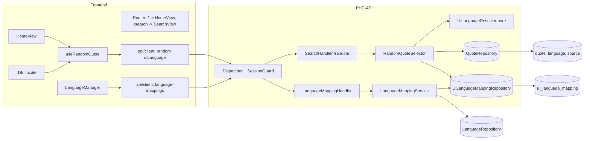
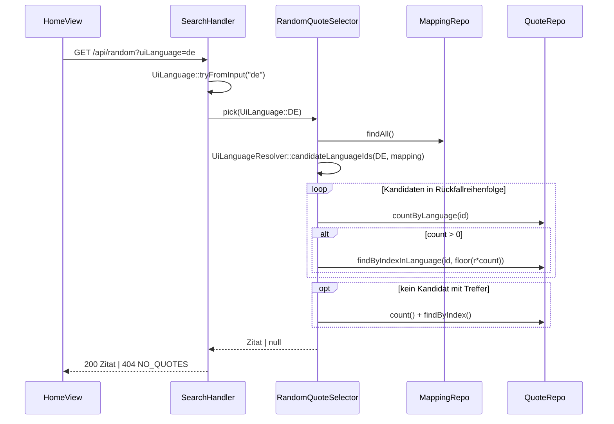
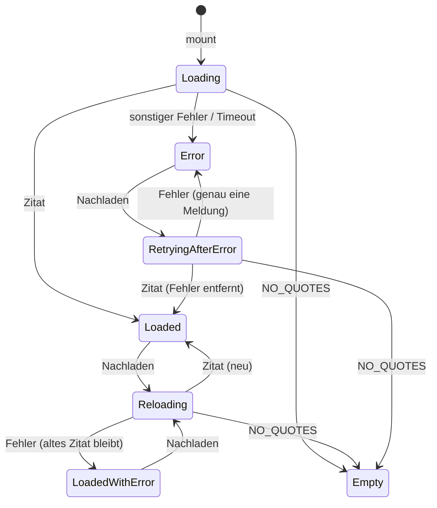

# Design-Dokument: random-quote-homepage

## Overview

Das Feature ergänzt die Citations-Anwendung um eine Startseite unter `/`, die pro Aufruf ein zufälliges Zitat zeigt. Es besteht aus drei zusammenhängenden Teilen:

1. **Frontend-Startseite** (`HomeView`): lädt über den vorhandenen API-Client `random()` ein Zitat, zeigt Lade-, Leer-, Fehler- und Erfolgszustand, bietet eine Nachladen-Schaltfläche und folgt dem Design-System aus `ui-redesign`. Die bisherige Such-Ansicht zieht nach `/search` um.
2. **Sprachpräferenz in `GET /api/random`**: ein optionaler, rückwärtskompatibler Query-Parameter `uiLanguage` (`de` | `en`). Die Auswahl bevorzugt Zitate in der der Oberflächensprache zugeordneten Zitat-Sprache, mit Rückfall auf die für `en` zugeordnete Sprache und zuletzt auf alle Zitate.
3. **Sprachzuordnung (1:1)**: neue Relation `ui_language_mapping`, neue Endpunkte `/api/language-mappings` und ein neuer Abschnitt in der Sprachverwaltung der Admin-Oberfläche.

### Recherche- und Analyseergebnisse (Bestand)

Die Codebasis wurde gelesen; folgende Befunde bestimmen das Design:

- `SearchHandler` bedient `GET /search` und `GET /random` (unterscheidet per `segments[0]`). `handleRandom()` ruft `RandomQuoteSelector::pick()`, der `RandomSelector::select($count, $r)` (rein) und `QuoteRepositoryInterface::findByIndex()` kombiniert. Die Zufallszahl kommt aus dem injizierbaren `RandomNumberGenerator`. Dieses Muster (reine Funktion + injizierter RNG + Repository) wird beibehalten.
- Repositories folgen dem Schema `XRepositoryInterface` / `PdoXRepository` / `LazyXRepository` (lazy PDO über `$pdoFactory` in `api/index.php`) mit `InMemoryXRepository` über `InMemoryStore` in `api/tests/Fake`.
- `Dispatcher` kennt die Routen fest verdrahtet; `Dispatcher::isWriteRoute()` / `isProtectedRoute()` steuern den `SessionGuard`, der **vor** jeder Handler-Validierung mit 401 ablehnt. Das erfüllt Anforderung 9.8 ohne Zusatzlogik, sobald die neuen Schreibrouten dort eingetragen sind.
- `ErrorCode` ist die zentrale Fehlercode-/HTTP-Status-Abbildung, im Frontend gespiegelt durch `ERROR_CODES` (`api/errorCodes.ts`) und `errors.<CODE>`-i18n-Schlüssel (`admin/errorMessage.ts`).
- Es gibt kein Migrations-Verzeichnis. Das Schema liegt in `db/schema.sql`, das die Integrationstests (`IntegrationTestCase`) droppen und neu einspielen. Für bestehende Datenbanken wird zusätzlich ein idempotentes Migrationsskript ergänzt.
- Frontend: Vue 3 + TypeScript, Vue Router (History-Modus, SPA-Fallback in `.htaccess`), eigenes i18n (`useI18n`, `messages.ts`, Locales `de`/`en`), SCSS-Design-Tokens, Vitest + `@vue/test-utils` + `fast-check`. Alle Verknüpfungen auf die Suche verwenden bereits `{ name: RouteName.Search, query }`. Eine Pfadänderung des Route-Records erhält daher Query-Parameter automatisch (Anforderung 5.8).
- `request()` in `api/http.ts` unterstützt `signal`, kennt aber kein Timeout. Das 10-Sekunden-Timeout wird deshalb in der Startseite über einen `AbortController` umgesetzt.
- `useI18n.lookup()` liefert bei fehlendem Schlüssel den Schlüsselnamen. Anforderung 6.5 (Rückfall auf die andere Sprache) erfordert eine kleine Erweiterung.

### Zentrale Designentscheidungen

| Entscheidung | Begründung |
|---|---|
| Sprachwahl als **reine Funktion** `UiLanguageResolver::candidateLanguageIds()` | Die Rückfallkette (6.7–6.10) ist Geschäftslogik mit großem Eingaberaum und deshalb gut per Property-Test prüfbar. |
| Genau **ein** RNG-Zug pro Anfrage, wiederverwendet für die gewählte Kandidatenmenge | Beibehalt der Determinismus-Eigenschaft von `RandomSelector`. |
| Zuordnung in **eigener Tabelle** mit `PRIMARY KEY (ui_language)` und `UNIQUE (language_id)` | Die Datenbank erzwingt die 1:1-Eigenschaft (9.1, 9.2) auch bei Parallelzugriffen. Die Anwendungsschicht prüft vorab für eine saubere 409-Antwort. |
| Neue Ressource `/api/language-mappings` statt Erweiterung von `/api/languages` | `languages` ist öffentlich lesbar und nur per POST schreibbar. Die Zuordnung hat eigene Semantik (Ersetzen, Entfernen) und eigene Fehlercodes. |
| Zuordnungs-Endpunkte als **Idempotente PUT/DELETE** auf `/{uiLanguage}` | PUT ersetzt die Zuordnung (9.4), DELETE entfernt sie (9.7). Wiederholtes DELETE ist ein Erfolg ohne Wirkung. |
| `uiLanguage` ungültig ⇒ wie bisher (alle Zitate), **nicht** Englisch-Rückfall | So verlangt es 6.7. Der Englisch-Rückfall gilt nur für gültige Werte ohne Treffer (6.9). |
| Zustandslogik der Startseite in Composable `useRandomQuote` | Trennt Zustandsautomat (testbar mit Test-Double des Clients) von der Darstellung. |
| Neuer Routenname `RouteName.Home`, Suche behält `RouteName.Search` | Bestehende `RouterLink`s mit Routennamen funktionieren unverändert. Nur Pfad und die Footer-Verknüpfung „Zufälliges Zitat“ ändern sich. |

## Architecture



### Ablauf `GET /api/random?uiLanguage=de`



### Zustandsautomat der Startseite



## Components and Interfaces

### Backend (PHP, `api/src`)

**`UiLanguage` (enum, neu)** – `enum UiLanguage: string { case DE = 'de'; case EN = 'en'; }` mit `static tryFromInput(mixed $value): ?self` (nur exakt `de`/`en` nach `trim`, sonst `null`). Einzige Quelle der unterstützten Oberflächensprachen.

**`UiLanguageResolver` (neu, rein)**

```php
final class UiLanguageResolver
{
    /**
     * @param array<string, int> $mapping Zuordnung 'de'|'en' => languageId (nur vorhandene Einträge)
     * @return list<int> Kandidaten-Sprach-IDs in Rückfallreihenfolge, ohne Duplikate.
     *                   Leer => keine Sprachpräferenz (alle Zitate).
     */
    public static function candidateLanguageIds(?UiLanguage $ui, array $mapping): array;
}
```

Regeln: `$ui === null` ⇒ `[]` (6.7). Sonst `[mapping[ui], mapping['en']]` ohne `null`-Werte und ohne Duplikate (6.8, 6.9). Der Gesamtrückfall (6.10) ist das Verhalten bei „kein Kandidat hat Zitate“.

**`RandomQuoteSelector::pick(?UiLanguage $ui = null)` (erweitert)**

Neuer Konstruktorparameter `UiLanguageMappingRepositoryInterface $mappings`. Ablauf: `r = rng->next()` (ein Zug); Kandidaten über den Resolver bestimmen; für jeden Kandidaten `n = countByLanguage(id)`; beim ersten `n > 0` `findByIndexInLanguage(id, RandomSelector::select(n, r))` zurückgeben; sonst Verhalten wie bisher über `count()`/`findByIndex()` (liefert `null` nur bei leerem Bestand, 6.10). Ohne `$ui` entfällt das Lesen der Zuordnung, das Verhalten ist identisch zu heute (8.2).

**`SearchHandler::handleRandom()` (erweitert)** – liest `uiLanguage` aus `$request->query`, wandelt über `UiLanguage::tryFromInput()` um (fehlend/leer/ungültig ⇒ `null`) und ruft `pick($ui)`. Antwortformat und Fehlercodes bleiben unverändert.

**`QuoteRepositoryInterface` (erweitert)** – zwei neue Methoden, umgesetzt in `PdoQuoteRepository`, `LazyQuoteRepository` und `InMemoryQuoteRepository`:

```php
public function countByLanguage(int $languageId): int;
/** @return QuoteRecord|null  Position im Sprach-Teilbestand, ORDER BY id ASC */
public function findByIndexInLanguage(int $languageId, int $index): ?array;
```

**`UiLanguageMappingRepositoryInterface` (neu)** mit `PdoUiLanguageMappingRepository`, `LazyUiLanguageMappingRepository`, `InMemoryUiLanguageMappingRepository`:

```php
/** @return array<string, int> 'de'|'en' => languageId, nur vorhandene Einträge */
public function findAll(): array;
public function findUiLanguageByLanguageId(int $languageId): ?string;
/** Ersetzt eine bestehende Zuordnung. false bei Verletzung der Eindeutigkeit (Race). */
public function assign(string $uiLanguage, int $languageId): bool;
public function remove(string $uiLanguage): void;
```

`assign` nutzt `INSERT ... ON DUPLICATE KEY UPDATE language_id = VALUES(language_id)` und fängt `PDOException` mit SQLSTATE `23000` auf `uq_ui_language_mapping_language` ab (⇒ `false`).

**`LanguageMappingService` (neu)** – analog `LanguageCreator`:

```php
public function assign(?UiLanguage $ui, int|null $languageId): LanguageMappingResult;
public function remove(?UiLanguage $ui): LanguageMappingResult;
```

Reihenfolge der Prüfung: unbekannte Oberflächensprache ⇒ `INVALID_UI_LANGUAGE`; nicht existierende/fehlerhafte Zitat-Sprache ⇒ `INVALID_LANGUAGE`; Zitat-Sprache bereits einer **anderen** Oberflächensprache zugeordnet (oder `assign` liefert `false`) ⇒ `LANGUAGE_ALREADY_MAPPED`. Die erneute Zuordnung derselben Sprache zur selben Oberflächensprache ist ein idempotenter Erfolg. Bei jedem Fehler bleibt der Bestand unverändert.

**`LanguageMappingHandler` (neu, `api/src/Http`)**

| Methode & Pfad | Zugriff | Verhalten |
|---|---|---|
| `GET /api/language-mappings` | öffentlich | `200 { "de": <id>\|null, "en": <id>\|null }` (9.3) |
| `PUT /api/language-mappings/{uiLanguage}` | Session | Body `{ languageId }`; `200 { uiLanguage, languageId }` (9.4) |
| `DELETE /api/language-mappings/{uiLanguage}` | Session | `200 { uiLanguage, languageId: null }`, idempotent (9.7) |

**`Dispatcher` / `SessionGuard`** – `Dispatcher::LANGUAGE_MAPPINGS = 'language-mappings'`; `match()` akzeptiert `GET` (1 Segment) und `PUT`/`DELETE` (2 Segmente, beliebiges zweites Segment, wird als `pathParams['uiLanguage']` übergeben, damit Validierung in der Anwendungsschicht erfolgt). `isWriteRoute()` wird um `PUT`/`DELETE` auf zwei Segmenten dieser Ressource erweitert. Damit lehnt der `SessionGuard` unauthentifizierte Schreibzugriffe vor jeder Validierung mit demselben 401 ab (9.8). Der Typ von `$pathParams` in `Handler` wird von `array<string, int>` auf `array<string, int|string>` erweitert.

**`ErrorCode` (erweitert)** – `INVALID_UI_LANGUAGE` ⇒ 400, `LANGUAGE_ALREADY_MAPPED` ⇒ 409. Wiederverwendet: `INVALID_LANGUAGE` (400), `UNAUTHORIZED` (401).

**`api/index.php`** – Verdrahtung: `LazyUiLanguageMappingRepository`, `RandomQuoteSelector` mit Mapping-Repository, neuer Handler in `$handlers`.

### Frontend (`frontend/src`)

**Router (`router/index.ts`)** – `RouteName.Home = 'home'` (`/`, `HomeView`), `RouteName.Search` zeigt auf `/search`. `/` mit Query-Parametern rendert die Startseite ohne Auswertung (5.10), da `HomeView` keine Query liest.

**`AppHeader.vue`** – genau zwei Navigationseinträge für Start und Suche (zusätzlich zur bestehenden Verwaltungs-Verknüpfung). Die Aktiv-Markierung nutzt weiter `router-link-exact-active`. `/` und `/search` sind getrennte Route-Records, daher ist immer nur einer aktiv (5.4, 5.5). **`AppFooter.vue`** – `search.randomQuote` verweist auf `{ name: RouteName.Home }` (5.6). Alle anderen Links verwenden `RouteName.Search` und bleiben unverändert (5.8).

**API-Client (`api/client.ts`, `api/types.ts`, `api/errorCodes.ts`)**

```ts
random(signal?: AbortSignal, uiLanguage?: Locale): Promise<QuoteDetail>   // abwärtskompatibel
getLanguageMappings(signal?: AbortSignal): Promise<LanguageMappings>
setLanguageMapping(uiLanguage: Locale, languageId: number): Promise<LanguageMapping>
removeLanguageMapping(uiLanguage: Locale): Promise<LanguageMapping>

type LanguageMappings = Record<Locale, number | null>
```

`ERROR_CODES` wird um `INVALID_UI_LANGUAGE` und `LANGUAGE_ALREADY_MAPPED` ergänzt; `errors.<CODE>`-Texte und `TRANSLATED_CODES` in `admin/errorMessage.ts` ebenso.

**`composables/useRandomQuote.ts` (neu)**

```ts
interface UseRandomQuote {
  quote: Ref<QuoteDetail | null>
  status: Ref<'idle' | 'loading' | 'ready' | 'empty' | 'error'>
  initialLoading: ComputedRef<boolean>   // erste Anfrage läuft, noch kein Ergebnis
  errorVisible: Ref<boolean>
  pending: Ref<boolean>                  // eine Anfrage läuft (Button deaktivieren)
  reload(): Promise<void>
  dispose(): void                        // Abbruch bei Unmount
}
function useRandomQuote(deps: { client: Pick<Api, 'random'>; locale: () => Locale; timeoutMs?: number }): UseRandomQuote
```

Verhalten: höchstens eine Anfrage gleichzeitig (`pending` blockiert `reload`); pro Anfrage ein `AbortController` mit `setTimeout(10_000)`; ein Timeout bricht ab und zählt als Fehler (1.8, 2.5, 4.2). Ein Abbruch durch `dispose()` ändert keinen Zustand und zeigt keine Meldung (3.5, 3.6). Die Unterscheidung erfolgt über ein internes `disposed`-Flag bzw. ein `timedOut`-Flag, nicht über den Fehlertyp. Locale wird bei **jedem** Aufruf frisch gelesen (6.11, 6.12). Ein Wechsel der Oberflächensprache löst keine Anfrage aus.

**`views/HomeView.vue` (neu)** – nutzt das Composable und stellt dar:

- `<h1>` (`home.heading`), genau eine Überschrift (7.2).
- Live-Region `<div aria-live="polite">`, **immer** gerendert (2.4); darin je nach Zustand `<figure><blockquote>` + `<figcaption>` mit Quellen-Link (`/sources/{id}`), Sprachname und Link `quote.openQuote` auf `/quotes/{id}` (1.4–1.6, 7.3).
- Ladezustand: genau ein `<p role="status">` mit `common.loading` (3.2, 3.3).
- Leerzustand `home.empty` ohne Zitat und ohne Schaltfläche (4.1, 1.9).
- Fehler: `<p role="alert">` mit `home.error`. Die Nachladen-Schaltfläche `home.reload` ist sichtbar, wenn ein Zitat angezeigt wird oder die erste Anfrage mit Nicht-`NO_QUOTES`-Fehler scheiterte (4.3). Sie ist `disabled`, solange `pending` (2.3, 4.4). Als natives `<button type="button">` ist sie per Tab, Enter und Leertaste bedienbar (2.1, 7.4, 7.5).
- Genau eine Verknüpfung auf `{ name: RouteName.Search }` mit `home.searchLink` (5.7).
- SCSS ausschließlich über Design-Tokens (`@use '@/scss/variables' as tokens`, `var(--…)`), Fokusindikator ≥ 2 px, `overflow-wrap: anywhere` für lange Zitate, einspaltiges Layout ab 320 px (7.1, 7.6–7.9).

**`i18n`** – neuer Abschnitt `home` (`heading`, `reload`, `empty`, `error`, `searchLink`; Ladetext über `common.loading`), `nav.home`, `admin.languageMappings*` und `errors.INVALID_UI_LANGUAGE` / `errors.LANGUAGE_ALREADY_MAPPED`, jeweils in `de` und `en`. Bestehende Schlüssel werden nicht verändert (6.6). `useI18n.lookup()` fällt bei fehlender Übersetzung zunächst auf die andere Sprache und erst danach auf den Schlüssel zurück (6.5).

**`LanguageManager.vue` + `AdminView.vue`** – `AdminView` lädt zusätzlich `api.getLanguageMappings()` zusammen mit den Sprachen und reicht `mappings` an `LanguageManager`. Neuer Abschnitt „Zuordnung der Oberflächensprachen“: je Oberflächensprache ein `<select>` mit Option „keine Zuordnung“ (`value=""`) und allen Sprachen, vorausgewählt mit der gespeicherten Zuordnung (9.9). Bei `change` ruft die Komponente `setLanguageMapping` bzw. `removeLanguageMapping`. Bei Erfolg erscheint eine Bestätigung (`role="status"`) und das Ereignis `changed` lädt Zuordnungen neu (9.10). Bei Fehler erscheint `apiErrorMessage(...)` in einem `role="alert"`-Bereich, und das `<select>` wird auf die zuletzt gespeicherte Zuordnung zurückgesetzt (9.11). `UNAUTHORIZED` löst wie bisher `unauthorized` aus.

## Data Models

### Tabelle `ui_language_mapping` (neu, `db/schema.sql`)

```sql
-- Zuordnung Oberflächensprache -> Zitat-Sprache (1:1, Anf. 9.1, 9.2).
CREATE TABLE ui_language_mapping (
    ui_language CHAR(2) NOT NULL,                 -- 'de' | 'en'
    language_id INT UNSIGNED NOT NULL,
    PRIMARY KEY (ui_language),                    -- höchstens ein Eintrag je Oberflächensprache
    UNIQUE KEY uq_ui_language_mapping_language (language_id),  -- jede Zitat-Sprache höchstens einmal
    CONSTRAINT chk_ui_language_mapping_ui CHECK (ui_language IN ('de', 'en')),
    CONSTRAINT fk_ui_language_mapping_language
        FOREIGN KEY (language_id) REFERENCES language (id)
        ON UPDATE CASCADE ON DELETE CASCADE
) ENGINE=InnoDB DEFAULT CHARSET=utf8mb4 COLLATE=utf8mb4_unicode_ci;
```

- Neuer Abschnitt in `db/schema.sql` (Position nach `language`). Zusätzlich `db/migrations/001_ui_language_mapping.sql` mit `CREATE TABLE IF NOT EXISTS` für bestehende Datenbanken; `db/README.md` verweist darauf.
- `IntegrationTestCase::resetDatabase()` ergänzt `ui_language_mapping` in der Truncate-Liste. Die `DROP TABLE IF EXISTS`-Liste folgt aus den `CREATE TABLE`-Anweisungen im Schema.
- Das Seed (`seed.sql`) bleibt unverändert: Ohne Zuordnungen verhält sich `/api/random?uiLanguage=…` wie bisher (6.9, 6.10).

### Payloads

| Endpunkt | Antwort |
|---|---|
| `GET /api/random[?uiLanguage=de\|en]` | unverändert: `{ id, text, languageId, languageName, source: { id, name } }` oder `404 NO_QUOTES` |
| `GET /api/language-mappings` | `{ "de": 1, "en": null }` |
| `PUT /api/language-mappings/de` mit `{ "languageId": 2 }` | `200 { "uiLanguage": "de", "languageId": 2 }` |
| `DELETE /api/language-mappings/de` | `200 { "uiLanguage": "de", "languageId": null }` |

Fehlerantworten nutzen das einheitliche Format `{ error, message }`: `400 INVALID_UI_LANGUAGE`, `400 INVALID_LANGUAGE`, `401 UNAUTHORIZED`, `409 LANGUAGE_ALREADY_MAPPED`.

### Frontend-Typen

```ts
type Locale = 'de' | 'en'
type LanguageMappings = Record<Locale, number | null>
interface LanguageMapping { uiLanguage: Locale; languageId: number | null }
```

## Correctness Properties

*Eine Property ist ein Merkmal oder Verhalten, das für alle gültigen Ausführungen eines Systems gelten soll, also eine formale Aussage darüber, was das System tun soll. Properties bilden die Brücke zwischen menschenlesbaren Spezifikationen und maschinell prüfbaren Korrektheitsgarantien.*

Der Einsatz von PBT ist hier für die reine Auswahl- und Zuordnungslogik (PHP, Eris), den Zustandsautomaten der Startseite, den i18n-Rückfall und die Router-Auflösung (TypeScript, fast-check) geeignet. Nicht per PBT geprüft werden Layout, Kontrast, Styling und Prozessanforderungen (siehe Testing Strategy).

### Property 1: Ungültiger uiLanguage verändert die Auswahl nicht

*Für jeden* Zitatbestand, jede Sprachzuordnung, jeden RNG-Wert `r ∈ [0,1)` und jeden `uiLanguage`-Wert, der weder `de` noch `en` ist (fehlend, leer, beliebiger String), liefert die Zufallsauswahl dasselbe Zitat wie die Auswahl über den gesamten Bestand mit `RandomSelector::select(count, r)`.

**Validates: Requirements 6.7, 8.2**

### Property 2: Rückfallkette der Sprachauswahl

*Für jeden* Zitatbestand, jede Sprachzuordnung, jede gültige Oberflächensprache `ui ∈ {de, en}` und jeden RNG-Wert `r` entspricht das gewählte Zitat dem Referenzmodell: (a) existiert für `ui` eine Zuordnung mit mindestens einem Zitat, wird das Zitat am Index `floor(r·n)` aus dem Teilbestand dieser Sprache gewählt; (b) sonst, falls für `en` eine Zuordnung mit mindestens einem Zitat existiert, aus dem Teilbestand dieser Sprache; (c) sonst aus dem Gesamtbestand.

**Validates: Requirements 6.8, 6.9, 6.10**

### Property 3: NO_QUOTES genau bei leerem Bestand

*Für jede* Sprachzuordnung und jeden `uiLanguage`-Wert (gültig oder nicht) liefert die Auswahl genau dann kein Zitat, wenn der Gesamtbestand leer ist; ist der Bestand nicht leer, wird immer ein existierendes Zitat geliefert.

**Validates: Requirements 6.10**

### Property 4: Antwortformat der Zufalls-API bleibt unverändert

*Für jedes* gewählte Zitat und jeden `uiLanguage`-Wert besitzt die Antwort von `GET /api/random` exakt die Felder `id`, `text`, `languageId`, `languageName` und `source{ id, name }` mit unveränderten Typen.

**Validates: Requirements 8.2**

### Property 5: Zuordnungs-Invarianten und Modelltreue unter beliebigen Operationsfolgen

*Für jede* Folge von Zuordnungs-Operationen (`assign(ui, languageId)` mit gültigen und ungültigen Argumenten, `remove(ui)`) gilt nach jedem Schritt: (a) jede Oberflächensprache hat höchstens einen Eintrag; (b) keine Zitat-Sprache ist mehreren Oberflächensprachen zugeordnet; (c) der Zustand entspricht einem einfachen Referenzmodell, in dem `assign` eine bestehende Zuordnung der Oberflächensprache ersetzt, `remove` den Eintrag löscht (auch wiederholt) und eine bereits anderweitig zugeordnete Sprache mit `LANGUAGE_ALREADY_MAPPED` abgelehnt wird; (d) nach `assign` liefert `GET` die zugeordnete ID, nach `remove` den Wert „keine Zuordnung“; (e) bei jedem abgelehnten Aufruf ist der Zustand identisch zum Zustand davor.

**Validates: Requirements 9.1, 9.2, 9.3, 9.4, 9.5, 9.7**

### Property 6: Ungültige Eingaben werden abgelehnt ohne Zustandsänderung

*Für jede* nicht unterstützte Oberflächensprache (beliebiger String außer `de`/`en`) und *jede* nicht existierende oder fehlerhafte Zitat-Sprach-ID liefert `assign` einen Validierungsfehler (`INVALID_UI_LANGUAGE` bzw. `INVALID_LANGUAGE`) und lässt den Datenbestand unverändert.

**Validates: Requirements 9.6**

### Property 7: Schreibzugriffe ohne Session werden vor der Validierung abgelehnt

*Für jede* Schreibanfrage (`PUT`/`DELETE`) auf `/language-mappings/{beliebiges Segment}` mit beliebigem Body ohne gültige Session antwortet die Pipeline mit derselben 401-Antwort wie die übrigen schreibenden APIs und lässt den Datenbestand unverändert, unabhängig davon, ob Segment und Body gültig wären. `GET /language-mappings` ist ohne Session erreichbar.

**Validates: Requirements 9.3, 9.8**

### Property 8: Zustandsautomat der Startseite

*Für jede* Folge von Ereignissen (`reload()`, Auflösen mit Zitat, Ablehnen mit `NO_QUOTES`, Ablehnen mit sonstigem Fehler, Timeout) gelten nach jedem Schritt: (a) höchstens eine Anfrage läuft gleichzeitig, und `reload()` während einer laufenden Anfrage löst keine weitere aus; (b) während der ersten Anfrage ist der Ladezustand sichtbar und weder Zitat noch Fehler; (c) nach Antwort oder Fehler ist der Ladezustand entfernt; (d) schlägt ein Nachladen fehl, bleibt ein zuvor angezeigtes Zitat unverändert und genau eine Fehlermeldung erscheint; (e) während eines Wiederholungsversuchs nach einem Fehler bleibt die Fehlermeldung bestehen und die Schaltfläche ist deaktiviert, bei Erfolg entfällt die Fehlermeldung; (f) zu keinem Zeitpunkt sind Zitat und Leerzustand gleichzeitig sichtbar.

**Validates: Requirements 2.3, 2.5, 3.3, 3.4, 4.4, 4.5, 4.6**

### Property 9: Das angezeigte Zitat stammt aus der letzten Antwort

*Für jede* Folge von Antworten der Zufalls-API zeigt die Startseite nach jedem erfolgreichen Laden genau das Zitat der letzten Antwort (kein Zwischenspeichern, keine Bevorzugung).

**Validates: Requirements 1.7**

### Property 10: Vollständige Darstellung und Verknüpfungen eines Zitats

*Für jedes* Zitat (beliebiger Text inkl. Sonderzeichen und langer Texte, beliebige IDs und Namen) enthält die Zitat-Anzeige Text, Quellenname und Sprachname, verknüpft den Quellennamen mit `/sources/{source.id}` und bietet eine Verknüpfung auf `/quotes/{id}`.

**Validates: Requirements 1.4, 1.5, 1.6**

### Property 11: Jeder Fehler außer NO_QUOTES führt zur Fehleranzeige mit Wiederholungsmöglichkeit

*Für jeden* Fehler der ersten Anfrage außer `NO_QUOTES` (HTTP-Fehler mit beliebigem Status und Code, Netzwerkfehler, Timeout) zeigt die Startseite genau einen `role="alert"`-Bereich, kein Zitat und eine Nachladen-Schaltfläche.

**Validates: Requirements 4.2, 4.3**

### Property 12: Der Sprachwechsel verändert den Zustand der Startseite nicht

*Für jeden* Zustand der Startseite (Laden, Zitat, Leerzustand, Fehler) und jeden Wechsel der Oberflächensprache bleiben Zustand und Zitatdaten (Text, Quelle, Sprachname) unverändert, es wird keine neue Anfrage gesendet und die statischen Texte erscheinen in der neuen Sprache.

**Validates: Requirements 6.2, 6.3, 6.4**

### Property 13: Die Anfrage trägt die aktuelle Oberflächensprache

*Für jede* Folge aus Sprachwechseln und `reload()`-Aufrufen trägt jeder `random()`-Aufruf (erstes Laden und Nachladen) die zum Aufrufzeitpunkt aktuelle Oberflächensprache als `uiLanguage`, und ein Sprachwechsel allein erzeugt keinen Aufruf.

**Validates: Requirements 6.11, 6.12**

### Property 14: i18n-Rückfall auf die andere Sprache

*Für jeden* Nachrichtenschlüssel, der in der aktiven Sprache fehlt oder leer ist, aber in der anderen Sprache vorhanden ist, liefert `t(key)` die Übersetzung der anderen Sprache und nie den rohen Schlüsselnamen; vorhandene Übersetzungen werden unverändert geliefert.

**Validates: Requirements 6.5**

### Property 15: Suchverknüpfungen erhalten die Query-Parameter, die Startseite ignoriert sie

*Für jede* Kombination der Query-Parameter `q`, `languages`, `sourceId` und `page` löst der Routenname `Search` mit dieser Query auf den Pfad `/search` mit unveränderten Werten auf, und derselbe Query-Satz an `/` löst weiterhin auf die Startseite auf.

**Validates: Requirements 5.8, 5.10**

### Property 16: Auswahl der Sprachverwaltung

*Für jede* Liste vorhandener Sprachen und jede gespeicherte Zuordnung zeigt die Sprachverwaltung je Oberflächensprache eine Auswahl mit allen Sprachen plus der Option „keine Zuordnung“ und wählt die gespeicherte Zuordnung vor (bzw. „keine Zuordnung“, wenn keine besteht).

**Validates: Requirements 9.9**

## Error Handling

### API

| Situation | Antwort |
|---|---|
| `uiLanguage` fehlt, leer oder ungültig | kein Fehler; Verhalten wie bisher (6.7) |
| Bestand komplett leer | `404 NO_QUOTES` (unverändert, 6.10) |
| Zuordnung: unbekannte Oberflächensprache im Pfad | `400 INVALID_UI_LANGUAGE`, keine Änderung |
| Zuordnung: `languageId` fehlt/ungültig/nicht vorhanden | `400 INVALID_LANGUAGE`, keine Änderung |
| Zitat-Sprache gehört bereits zu anderer Oberflächensprache (auch bei Race über `UNIQUE`) | `409 LANGUAGE_ALREADY_MAPPED`, keine Änderung |
| Schreibzugriff ohne gültige Session | `401 UNAUTHORIZED` durch `SessionGuard`, vor jeder Validierung |
| `DELETE` ohne bestehenden Eintrag | `200`, keine Wirkung (idempotent) |
| `PDOException`/Konfigurationsfehler | generischer `500` über `ErrorMapper`, ohne interne Details |
| Nicht unterstützte Methode / unbekannter Pfad | `404 NOT_FOUND` wie bisher |

Die Mapping-Schreibpfade laufen in einer Transaktion (Prüfen und Schreiben), die `UNIQUE`-/`PRIMARY KEY`-Constraints sind der Backstop gegen Parallelzugriffe.

### Frontend

- **Fehler, Timeout, Netzwerk**: `useRandomQuote` fängt jeden Fehler. `ApiError` mit `code === 'NO_QUOTES'` ⇒ Leerzustand; alle anderen ⇒ Fehlerzustand. Das Timeout von 10 s wird über `AbortController` + `setTimeout` umgesetzt und bei Abschluss mit `clearTimeout` bereinigt.
- **Abbruch durch Unmount**: `dispose()` bricht die laufende Anfrage ab und setzt ein `disposed`-Flag. Eine danach eintreffende Antwort oder ein `AbortError` ändert weder Zustand noch zeigt sie eine Meldung (3.5, 3.6).
- **Veraltete Antworten**: Jede Anfrage trägt eine laufende Nummer, nur die aktuelle darf Zustand setzen (verhindert Überschreiben durch späte Antworten nach Timeout).
- **Sprachverwaltung**: Fehler beim Speichern ⇒ `apiErrorMessage()` in `role="alert"`, `<select>` zurück auf zuletzt gespeicherten Wert; `UNAUTHORIZED` ⇒ bestehendes `unauthorized`-Ereignis (Login-Gate).
- **i18n**: fehlende Übersetzung ⇒ andere Sprache, dann Schlüsselname.

## Testing Strategy

### Ansatz

Unit-/Beispieltests und Property-Tests ergänzen sich: Beispiele decken konkrete Zustände, Strukturen und Integrationspunkte ab, Properties die allgemeinen Invarianten über große Eingaberäume. Property-Tests verwenden vorhandene Bibliotheken und werden nicht selbst implementiert.

### Property-Based Tests

- **PHP**: Eris (`giorgiosironi/eris`, bereits in `composer.json`), Basisklasse `PropertyTestCase` (mindestens 100 Iterationen), Dateien unter `api/tests/Property`.
- **TypeScript**: `fast-check` (bereits in `devDependencies`) mit Vitest, `numRuns: 100` oder höher.
- Jede Correctness Property wird durch **genau einen** Property-Test umgesetzt und im Kommentar getaggt: `Feature: random-quote-homepage, Property {Nummer}: {Titel}`.

| Property | Test (Datei) |
|---|---|
| 1, 2, 3 | `api/tests/Property/RandomQuoteLanguageSelectionPropertyTest.php` (InMemory-Repos, fixer RNG; Referenzmodell) |
| 4 | `api/tests/Property/RandomResponseShapePropertyTest.php` |
| 5, 6 | `api/tests/Property/LanguageMappingServicePropertyTest.php` (Operationsfolgen gegen Referenzmodell) |
| 7 | Erweiterung von `SessionGuardWriteProtectionPropertyTest.php` um die neue Ressource |
| 8, 9, 11, 12, 13 | `frontend/src/composables/useRandomQuote.property.test.ts` und `views/HomeView.property.test.ts` (steuerbare Promises, Fake-Timer) |
| 10 | `views/HomeView.property.test.ts` |
| 14 | `i18n/fallback.property.test.ts` |
| 15 | `router/homeSearchRoutes.property.test.ts` |
| 16 | `components/admin/LanguageManager.mapping.property.test.ts` |

### Beispiel- und Unit-Tests

- **PHP** (`api/tests/Unit`): `UiLanguageResolverTest`, `RandomQuoteSelectorTest` (erweitert: Sprachpräferenz, `en`-Rückfall, Gesamtrückfall; Anforderung 9.13), `SearchHandlerTest` (Parameter `uiLanguage` fehlend/ungültig/gültig), `LanguageMappingHandlerTest` (GET öffentlich, PUT ersetzen, 409-Konflikt, 400-Fälle, DELETE idempotent, 401 ohne Session), `DispatcherTest` (neue Routen, `isWriteRoute`), `ErrorCodeTest` (neue Codes und Statuswerte), `InMemoryQuoteRepository`-Sprachmethoden.
- **PHP-Integration** (`api/tests/Integration`, nur mit Test-DB, sonst übersprungen): `UiLanguageMappingIntegrationTest` prüft `PRIMARY KEY`/`UNIQUE`/FK gegen MariaDB (1:1-Eindeutigkeit, Ersetzen, Entfernen, `ON DELETE CASCADE`) und `findByIndexInLanguage`/`countByLanguage` in `PdoQuoteRepository`. `IntegrationTestCase` ergänzt `ui_language_mapping` in der Truncate-Liste.
- **Frontend** (Vitest, Test-Double des API-Clients, kein Netzwerk): `HomeView.test.ts` mit mindestens je einem Test für Erfolg, Laden, `NO_QUOTES`, Fehler, Nachladen (Anforderung 8.4), außerdem Timeout (Fake-Timer), Abbruch bei Unmount, genau eine Anfrage pro Aufruf, `aria-live`, `role="status"`/`role="alert"`, genau ein `<h1>`, `blockquote`/`figcaption` im selben `figure`, genau eine Such-Verknüpfung. Zusätzlich: `router/index.test.ts` (`/` → Home, `/search` → Search), `AppHeader.test.ts` (zwei Einträge, Aktiv-Markierung), `AppFooter` (`search.randomQuote` → `/`), `api/client.test.ts` (`uiLanguage` im Query, neue Mapping-Methoden), `i18n/messages.test.ts` (neue Schlüssel in `de` und `en` nicht leer), `admin/LanguageManager` (Speichern, Bestätigung, Fehler mit Rücksetzen).
- **Angepasste Bestandstests**: Tests, die die Suche unter `/` prüfen (`router/index.test.ts`, `SearchView.test.ts`, `AppHeader.test.ts`, ggf. `routeSet.property.test.ts`, `KeyboardReachability.property.test.ts`), werden auf `/search` bzw. die Startseite angepasst. Alle übrigen Tests bleiben unverändert und dürfen nicht abgeschwächt werden (8.3, 8.5).
- **Statische Stiltests**: `tokenConsistency`, `elementConsistency`, `contrast`, `focusContrast` und `MobileOverflow` werden um `HomeView.vue` erweitert (keine Literalwerte, Fokus ≥ 2 px, Kontrast, `overflow-wrap`). Layout und Kontrast sind nicht per PBT prüfbar; die WCAG-Konformität ersetzt keine manuelle Prüfung mit Hilfstechnologien.

### Ausführung

- API: `cd api && composer test` (Unit + Property; Integration optional mit `CITATIONS_IT_DB_*`).
- Frontend: `cd frontend && npm test` (`vitest run`) und `npm run typecheck`.
