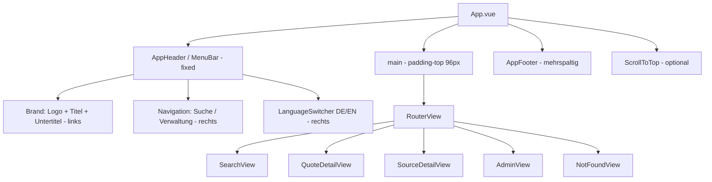

# Design Document

## Overview

Dieses Design beschreibt die visuelle Überarbeitung (UI-Redesign) des Citations-Frontends (Vue 3 + TypeScript + Vite) und richtet das Erscheinungsbild am Look-and-feel der Referenz-Website mhitzelberger.de aus. Die konkreten, verbindlichen Design-Tokens (Farben, Typografie, Abstände, Breakpoints, Layout) wurden aus dem Schwesterprojekt myNewWebsite (Vue 3 + SCSS) ausgelesen und sind in diesem Dokument als Zielwerte festgeschrieben.

**Scope:** Die Überarbeitung betrifft ausschließlich Gestaltung und Layout (Farben, Typografie, Platzierung, Interaktions-Styling, responsives Verhalten). Die gesamte bestehende Funktionalität – Routen, Views, Props, API-Aufrufe, i18n-Schlüssel, Verhalten der Komponenten – bleibt unverändert erhalten (Req 8). Es werden keine neuen fachlichen Datenmodelle, keine neuen Routen und keine geänderten i18n-Schlüssel eingeführt.

**Ausgangslage (zu transformierender Zustand):** Das Frontend verwendet aktuell kein Sass, kein globales Stylesheet, keine zentralen Design-Tokens und keine Webschrift. Komponenten nutzen `<style scoped>` mit fest einkodierten Werten (z. B. `#b00020` für Fehler, `#666`/`#555` für Grautöne). `App.vue` besitzt einen einfachen, nicht fixierten `<header class="app-header">` und synchronisiert bereits das `lang`-Attribut des Dokuments mit der aktiven i18n-Locale (erfüllt Req 9.5). Der Router stellt fünf Routen bereit: `/` (Search), `/quotes/:id` (QuoteDetail), `/sources/:id` (SourceDetail), `/admin` (Admin) und den Catch-all (NotFound). Die Navigation kennt nur zwei Ziele: `nav.search` und `nav.admin`.

**Designziel:** Einführung eines zentralen Design-Systems als alleinige Quelle für alle Gestaltungswerte (Req 1), konsequente Anwendung der dunklen Palette mit Lila-Akzenten (Req 2), Nunito-Typografie (Req 3), fixierte Menüleiste und mehrspaltiger Fußbereich (Req 4), durchgängige Anwendung auf alle Views (Req 5), einheitliche interaktive Elemente (Req 6), responsives Verhalten über definierte Breakpoints (Req 7), vollständiger Funktionserhalt (Req 8) und erhaltene Barrierefreiheit (Req 9).

## Architecture

### Styling-Technologie: Einführung von Sass

Das Redesign führt Sass als Styling-Schicht ein (dev-Abhängigkeit `sass`, identisch zum Vorgehen in myNewWebsite). Vite unterstützt `.scss` und `@use`/`@forward` ohne zusätzliche Plugins, sobald `sass` installiert ist. Damit lässt sich die bewährte SCSS-Struktur der Referenz übernehmen und die Tokens an einer einzigen Stelle pflegen (Req 1.1).

### Verzeichnisstruktur `frontend/src/scss/`

Die SCSS-Dateien spiegeln die Struktur aus myNewWebsite:

- `_variables.scss` — zentrale Definitionsstelle aller Design-Tokens als SCSS-Variablen **und** gespiegelt als CSS-Custom-Properties auf `:root`. Dies ist die alleinige Quelle (Req 1.1, 1.4).
- `_mixins.scss` — Mixins `respond-to($breakpoint)` (Media-Queries aus der Breakpoint-Skala) und `transition($props...)` (einheitliche `0.3s ease`-Übergänge, Req 6.2).
- `_base.scss` — `@font-face` für Nunito (Req 3.1, 3.5), CSS-Reset, globale Typografie (Fließtext, H1–H6, Req 3.2–3.4), Link-Gestaltung (Req 6.2), Divider.
- `_utilities.scss` — Container (max-width 1200px, zentriert, seitliches Padding, Req 4.4/7.5), Flex- und Abstands-Hilfsklassen aus der Abstandsskala (Req 4.6).
- `main.scss` — Aggregator, der die Teildateien per `@use` bündelt.

`main.scss` wird genau einmal importiert, und zwar in `frontend/src/main.ts` (neben dem bestehenden `createApp`/`router`/`i18n`-Setup). Dadurch gelten die globalen Stile und Tokens anwendungsweit (Req 5.1).

### Tokens als alleinige Quelle: SCSS-Variablen plus CSS-Custom-Properties

Design-Tokens werden in `_variables.scss` zunächst als SCSS-Variablen definiert (z. B. `$color-primary: #C15BEB;`) und zusätzlich auf `:root` als CSS-Custom-Properties gespiegelt (z. B. `--color-primary: #{$color-primary};`). Begründung:

1. **Build-Zeit-Sicherheit (Req 1.5):** Verweist eine Komponente auf eine **nicht** definierte SCSS-Variable, bricht der Sass-Compiler den Build mit einem Fehler ab ("Undefined variable"). So wird ein nicht definierter Token beim Build als Fehler gemeldet und der Build abgebrochen.
2. **Laufzeit-Nutzung:** Die gespiegelten CSS-Custom-Properties erlauben Token-Nutzung zur Laufzeit (z. B. für zustandsabhängige Stile, Theming-Overrides, maschinelles Auslesen in Tests). Eine Änderung eines Tokens an der zentralen Stelle wirkt ohne weitere Codeänderung überall (Req 1.4).

Komponentenstile beziehen Werte ausschließlich über diese Tokens – entweder über SCSS-Variablen (Build-geprüft) oder über `var(--token)` (Laufzeit). Fest einkodierte Farb-, Abstands-, Radius- oder Schattenwerte sind nicht zulässig (Req 1.3, 2.2, 4.6).

### Schrift-Laden (Nunito) über `public/fonts`

Die variable Nunito-Schrift (Gewicht 200–1000) wird als TTF unter `frontend/public/fonts/` abgelegt und in `_base.scss` per `@font-face` mit `font-weight: 200 1000` und `font-display: swap` eingebunden. `font-display: swap` stellt sicher, dass bei verzögertem oder fehlgeschlagenem Laden sofort die Ersatzschrift `sans-serif` sichtbar ist und die Textdarstellung nicht abbricht (Req 3.5). Da die Datei über `public/` ausgeliefert wird, ist der `url()`-Pfad stabil (`/fonts/...`) und benötigt keine Bundler-Auflösung.

### Keine Änderung an Router, i18n, API

Die Architektur fügt ausschließlich eine Styling-Schicht und drei Layout-Komponenten (siehe unten) hinzu. `router/index.ts`, `api/*`, `i18n/*` und die fachliche Logik der Views bleiben unangetastet (Req 8.1–8.4).

## Components and Interfaces

### Layout-Diagramm

### Neue Komponente: `AppHeader` (MenuBar)

Ersetzt den bestehenden einfachen `<header class="app-header">` in `App.vue`.

- **Darstellung:** am oberen Rand fixiert (`position: fixed`, `z-index: 1000`), Hintergrund `$color-background` (#282D37), `box-shadow` (Req 4.1).
- **Aufbau (space-between):** Brand-Bereich (Logo, Titel `app.title`, optionaler Untertitel) linksbündig; Navigation und `LanguageSwitcher` rechtsbündig (Req 4.1).
- **Navigation:** nur die real vorhandenen Routen. Die Referenz-Website hat Ziele wie Blog/Books, die hier **nicht** existieren – die Navigation wird um die tatsächlichen Routen herum gebaut: `nav.search` (→ RouteName.Search) und `nav.admin` (→ RouteName.Admin). Aktive Route erhält einen 2px-Unterstrich-Indikator in #C15BEB über die `router-link-active`-Klasse (Req 6.3).
- **Compact-on-scroll:** Ein Scroll-Listener schaltet beim vertikalen Scrollen eine Modifikator-Klasse (z. B. `app-header--compact`) um, die Höhe/Padding reduziert (Req 4.2).
- **Responsiv:** ab Breakpoint md (768px) horizontale Navigationsleiste in der fixierten Leiste; unterhalb md ein Hamburger-Menü mit Slide-in (Req 7.2, 7.3).

### Neue Komponente: `AppFooter`

- Mehrspaltiger Fußbereich am unteren Rand: ab 768px bis zu vier Spalten, unterhalb 768px zwei Spalten (Req 4.5), umgesetzt per CSS-Grid und `respond-to(md)`.
- Nutzt ausschließlich Tokens für Farben, Abstände und Typografie und verwendet vorhandene i18n-Schlüssel; es werden keine neuen Schlüssel eingeführt (Req 8.3).

### Optionale Komponente: `ScrollToTop`

- Schaltfläche unten rechts, erscheint nach Scroll-Schwelle, scrollt sanft nach oben. Vollständig token-basiert gestaltet, tastaturbedienbar mit sichtbarem Fokusindikator (Req 6.4, 9.3).

### Restyling: `LanguageSwitcher`

- Beibehaltung von Verhalten und i18n-Schlüsseln (`language.label`, `language.de`, `language.en`); `setLocale`-Logik bleibt unverändert (Req 8.3, 8.4).
- Visuell an den DE/EN-Umschalter der Referenz angelehnt. Die bestehende `<label>`+`<select>`-Semantik wird beibehalten, um Zugänglichkeit und Testverhalten zu erhalten (Req 9.2); die Gestaltung erfolgt über Tokens. Falls ein button-basierter DE/EN-Umschalter umgesetzt wird, bleiben Rollen, Namen und Zustände über den Accessibility-Tree äquivalent erhalten (Req 9.2).

### Zuordnung bestehender Views zum token-basierten Styling

Jede View behält Markup-Struktur, BEM-Klassennamen, Props und Logik; nur die `<style scoped>`-Werte werden auf Tokens umgestellt (Req 5.2–5.6):

- **SearchView.vue** — Formular, Statusmeldungen (`#b00020` → Status-Fehlerfarbe-Token), Ergebnisliste (`#666`/grau → Text-/Sekundär-Token), Pagination. Abstände aus der Abstandsskala (Req 4.6).
- **QuoteDetailView.vue** — Detaildarstellung und Links auf Token-Farben.
- **SourceDetailView.vue** — Metadaten, „Zitate dieser Quelle“-Verknüpfung.
- **AdminView.vue** und `components/admin/*` (AdminLogin, QuoteManager, SourceManager, LanguageManager, DeleteSourceDialog) — Formular-, Tab-, Tabellen- und Dialog-Styling token-basiert; Validierungs-/Fehlerzustände über Status-Tokens (Req 6.6).
- **NotFoundView.vue** — nutzt denselben Kopf-/Navigationsbereich wie alle anderen Views (durch globalen `AppHeader` in `App.vue` automatisch gegeben) und das überarbeitete Design (Req 5.6).
- **LengthLimitedInput.vue** — Eingabefeld-Styling (Fokus, Fehlerzustand) über Tokens (Req 6.1, 6.4).

Alle Routen, Pfade und View-Zuordnungen bleiben identisch (Req 8.1).

## Data Models

Dieses Feature führt **keine neuen fachlichen Datenmodelle** ein (Zitate, Quellen, Sprachen bleiben unverändert). Modelliert wird allein das Design-Token-System.

### Design-Token-Modell

Ein Design-Token ist ein benannter, zentral definierter Gestaltungswert. Jeder Token hat eine Kategorie, einen Namen und einen Wert. Es gibt fünf Kategorien, jede mit mindestens einem Token (Req 1.1).

| Kategorie | Token | Wert |
|---|---|---|
| color | `background` (Gunmetal) | `#282D37` |
| color | `text` | `#fff` |
| color | `primary` / accent (purple-light) | `#C15BEB` |
| color | `purple-dark` | `#39107B` |
| color | `purple-medium` (Sekundär) | `#6C3483` |
| color | `purple-bright` | `#e49eff` |
| typography | `font-family` | `'Nunito', sans-serif` (variabel, Gewicht 200–1000) |
| typography | `font-size-base` | `16px` |
| typography | `line-height-body` | `1.6` |
| typography | `line-height-heading` | `1.2` |
| typography | `font-weight-heading` | `700` |
| typography | `h1`…`h6` | `2.5 / 2 / 1.75 / 1.5 / 1.25 / 1` rem |
| spacing | `xs/sm/md/lg/xl/xxl` | `0.25 / 0.5 / 1 / 1.5 / 2 / 3` rem |
| radius | `radius` (mind. 1 Token) | z. B. `0.5rem` |
| shadow | `shadow` (mind. 1 Token) | z. B. `0 2px 8px rgba(0,0,0,0.4)` |

Radius und Schatten sind in der Referenz nicht hartkodiert vorgegeben; es wird je Kategorie mindestens ein Token definiert, der mit der dunklen Palette harmoniert (Req 1.1).

### Statusfarben (neu festzulegen, Req 2.4)

Die Referenz definiert keine expliziten Statusfarben. Es wird genau eine Farbe je Status (Erfolg, Fehler, Hinweis) neu festgelegt. Jede harmoniert mit der dunkel-lila Palette und muss auf dem Gunmetal-Hintergrund #282D37 die Kontraststufe WCAG AA erfüllen (Req 2.3/2.4): mindestens 4,5:1 für normalen Text bzw. mindestens 3:1 für großen Text/Bedienelemente.

Hintergrund #282D37 hat eine relative Luminanz von ca. 0,0273. Daraus ergeben sich die Schwellen: ≥ 0,164 für 3:1 und ≥ 0,254 für 4,5:1. Vorgeschlagene, auf diesen Schwellen geprüfte Werte:

| Status | Token | Hex | Kontrast gegen #282D37 (ca.) |
|---|---|---|---|
| Erfolg (success) | `color-success` | `#56D97E` | ≈ 7,6:1 — erfüllt 4,5:1 |
| Fehler (error) | `color-error` | `#FF6B6B` | ≈ 5,1:1 — erfüllt 4,5:1 |
| Hinweis (info) | `color-info` | `#e49eff` (purple-bright) | ≈ 7,1:1 — erfüllt 4,5:1 |

Die drei Statusfarben sind voneinander unterscheidbar (grün / rot / lila); info reicht in die bestehende Lila-Palette hinein und bindet die Statusfarben an das Gesamtbild. Die exakten Kontrastwerte werden im Test gegen die WCAG-Formel verifiziert (siehe Testing Strategy). Der bisher hartkodierte Fehlerton `#b00020` wird durch `color-error` ersetzt.

### Fallback-Werte (Req 2.5)

Wird ein nicht in der Palette vorhandener Farbwert angefordert, gilt als Rückfall die Hintergrundfarbe #282D37 und die Textfarbe #fff; das betroffene Element wird weiterhin sichtbar dargestellt, ohne dass die Darstellung abbricht.

## Correctness Properties

*Eine Eigenschaft (Property) ist ein Merkmal oder Verhalten, das über alle gültigen Ausführungen eines Systems hinweg wahr sein soll – im Kern eine formale Aussage darüber, was das System tun soll. Properties bilden die Brücke zwischen menschenlesbaren Spezifikationen und maschinell überprüfbaren Korrektheitsgarantien.*

Obwohl es sich um ein UI-Redesign handelt, lassen sich mehrere Anforderungen als allgemeingültige Invarianten über eine große Eingabemenge formulieren (Token-Auflösung, Kontrastberechnung, Routen-/Schlüsselmengen, Fokus- und Tastatur-Invarianten). Für diese Kriterien ist eigenschaftsbasiertes Testen sinnvoll; rein darstellungs- oder konfigurationsgebundene Kriterien (konkrete Pixelwerte, Build-Verhalten, Snapshot-Prozess) werden stattdessen über Beispiel-, Integrations- und Smoke-Tests abgedeckt (siehe Testing Strategy).

### Property 1: Alle Gestaltungswerte stammen aus Tokens

*Für alle* sichtbaren Oberflächenelemente der Kategorien App-Header, Inhaltsbereich, Schaltflächen, Verknüpfungen und Formularelemente gilt: jeder verwendete Farb-, Abstands-, Radius- und Schattenwert ist Element der definierten Token-Menge; es existiert kein fest einkodierter Wert außerhalb der Tokens.

**Validates: Requirements 1.3, 2.2, 4.6, 5.2, 5.3, 5.4, 5.5, 5.6**

### Property 2: Token-Änderung wirkt konsistent überall

*Für jede* Änderung eines Token-Werts an der zentralen Definitionsstelle gilt: der zur Laufzeit aufgelöste Wert jedes Elements, das diesen Token referenziert, ist gleich dem neuen Token-Wert.

**Validates: Requirements 1.4**

### Property 3: Kontrastverhältnisse erfüllen WCAG AA

*Für alle* Kombinationen aus Text- und Hintergrundfarbe der definierten Palette (einschließlich #fff auf #282D37, Verknüpfungen in #C15BEB und der drei Statusfarben) gilt: das berechnete Kontrastverhältnis beträgt mindestens 4,5:1 für normalen Text und mindestens 3:1 für großen Text bzw. grafische Bedienelemente.

**Validates: Requirements 2.3, 2.4, 9.1**

### Property 4: Statusfarben sind unterscheidbar

*Für jedes* Paar der drei Statusfarben (Erfolg, Fehler, Hinweis) gilt: die beiden Farbwerte sind ungleich.

**Validates: Requirements 2.4**

### Property 5: Typografie wird typgerecht aufgelöst

*Für alle* gerenderten Textelemente gilt: die aufgelöste Schriftfamilie, Schriftgröße, Zeilenhöhe und das Schriftgewicht entsprechen den für den jeweiligen Typ (H1–H6 oder Fließtext) definierten Token-Werten.

**Validates: Requirements 3.4**

### Property 6: Gleiche Elementtypen sind identisch gestaltet

*Für alle* Paare von Instanzen desselben interaktiven Elementtyps (Schaltfläche, Verknüpfung, Eingabefeld, Auswahlfeld) gilt: die aufgelösten Gestaltungswerte für Typografie, Abstände, Rahmen und Farben sind identisch.

**Validates: Requirements 6.1**

### Property 7: Fokusindikatoren erfüllen Kontrast

*Für alle* fokussierbaren interaktiven Elemente gilt: der sichtbare Fokusindikator weist gegenüber dem angrenzenden Hintergrund ein Kontrastverhältnis von mindestens 3:1 auf.

**Validates: Requirements 6.4, 9.4**

### Property 8: Kein horizontaler Überlauf im Mobilbereich

*Für alle* Viewport-Breiten im Bereich von 320px bis unter 768px gilt: der Inhalt erzeugt kein horizontales Scrollen, und alle interaktiven Elemente liegen vollständig innerhalb der Viewport-Breite.

**Validates: Requirements 7.4**

### Property 9: Routen- und View-Menge bleibt unverändert

*Für jede* vor dem Redesign vorhandene Route gilt: nach dem Redesign existiert dieselbe Route unter identischem Pfad mit identisch zugeordneter View, und es existiert keine zusätzliche oder entfernte Route.

**Validates: Requirements 8.1**

### Property 10: i18n-Schlüssel bleiben erhalten

*Für jeden* vor dem Redesign vorhandenen Internationalisierungs-Textschlüssel gilt: derselbe Schlüssel existiert nach dem Redesign in jedem Sprachkatalog, ohne Entfernung oder Umbenennung.

**Validates: Requirements 8.3**

### Property 11: Semantik und ARIA bleiben äquivalent

*Für jede* Komponente gilt: die über den Accessibility-Tree abrufbaren Rollen, Namen und Zustände sind nach dem Redesign äquivalent zu denen vor dem Redesign.

**Validates: Requirements 9.2**

### Property 12: Tastatur-Erreichbarkeit aller interaktiven Elemente

*Für jede* View gilt: die Menge der per Tabulator erreichbaren Elemente ist nicht leer und umfasst alle interaktiven Elemente der View in einer der visuellen Anordnung entsprechenden Reihenfolge; ist ein interaktives Element nicht erreichbar, schlägt der Barrierefreiheitstest fehl.

**Validates: Requirements 9.3, 9.6**

### Property 13: Lang-Attribut folgt der aktiven Locale

*Für jede* Folge von Sprachumschaltungen gilt: nach jedem Wechsel entspricht das `lang`-Attribut des Dokuments dem ISO-639-1-Code der neu aktiven Locale.

**Validates: Requirements 9.5**

## Error Handling

### Schrift-Ladefehler (Req 3.5)

Das `@font-face` für Nunito verwendet `font-display: swap`, und die `font-family`-Kette endet auf `sans-serif`. Lädt Nunito nicht (oder nicht innerhalb der Toleranz des Browsers), rendert der Text sofort in der Ersatzschrift `sans-serif`; die Darstellung wird nicht abgebrochen. Es ist keine JavaScript-gestützte Zeitüberwachung erforderlich – das Verhalten ist rein deklarativ über CSS gelöst.

### Nicht definierter Token → Build-Fehler (Req 1.5)

Da Komponentenstile Tokens als SCSS-Variablen referenzieren, erzeugt ein Verweis auf eine an der zentralen Definitionsstelle **nicht** vorhandene Variable einen Sass-Compile-Fehler ("Undefined variable"). Dieser Fehler bricht `vite build` ab (das Build-Skript führt `vue-tsc --noEmit && vite build` aus). So wird ein nicht definierter Token deterministisch zur Build-Zeit als Fehler gemeldet, bevor Artefakte entstehen. Dies wird durch einen Integrationstest abgesichert (siehe Testing Strategy).

### Unbekannter Farbwert → Fallback (Req 2.5)

Für den Fall, dass zur Laufzeit ein Farbwert angefordert wird, der nicht in der Palette existiert, definiert `_base.scss`/`_utilities.scss` Rückfallregeln: Hintergrund `#282D37`, Text `#fff`. Das betroffene Element bleibt sichtbar; es erfolgt kein Darstellungsabbruch. Praktisch wird dies über CSS-Custom-Property-Fallbacks umgesetzt, z. B. `color: var(--color-x, #fff)` und `background: var(--color-bg-x, #282D37)`.

### Fehlerzustände von Formularelementen (Req 6.6)

Ungültige Pflichtfelder erhalten einen vom Normalzustand visuell unterscheidbaren Fehlerzustand (Rahmen/Hintergrund über `color-error`-Token, Kontrast ≥ 3:1) zuzüglich einer textuellen Fehlermeldung über die bestehenden `errors.*`-i18n-Schlüssel. Es werden keine neuen Fehlerschlüssel eingeführt (Req 8.3).

## Testing Strategy

### Werkzeuge

Bestehend: Vitest + @vue/test-utils, Snapshot-Tests unter `src/views/__snapshots__`, `*.test.ts` neben Views/Komponenten. Neu als dev-Abhängigkeiten: `sass` (Styling) und `fast-check` (eigenschaftsbasiertes Testen, bereits in myNewWebsite verwendet). Property-Tests laufen mit **mindestens 100 Iterationen** und werden mit einem Kommentar im Format **Feature: ui-redesign, Property {n}: {Eigenschaftstext}** annotiert; jede Korrektheitseigenschaft wird durch **genau einen** Property-Test umgesetzt.

### Eigenschaftsbasierte Tests (Properties 1–13)

- **Property 1 / 6 (Token-Herkunft, Elementtyp-Konsistenz):** Generatoren erzeugen Komponenten-/Stilinstanzen; der Test prüft, dass aufgelöste Werte in der Token-Menge liegen bzw. für gleiche Typen identisch sind.
- **Property 3 / 4 / 7 (Kontrast, Statusfarben, Fokus):** Generator über alle Paletten-/Statusfarbkombinationen; Assertion über die WCAG-Kontrastformel (relative Luminanz) gegen die Schwellen 4,5:1 bzw. 3:1; Unterscheidbarkeit der Statusfarben.
- **Property 5 (Typografie):** Generator über Textelementtypen H1–H6/Body; Vergleich der aufgelösten Typografiewerte mit Token-Vorgaben.
- **Property 2 (Token-Konsistenz):** Generator über Token-Wertänderungen auf `:root`; Prüfung, dass `getComputedStyle` referenzierender Elemente den neuen Wert liefert.
- **Property 8 (kein Overflow):** Generator über Viewport-Breiten 320..<768; Prüfung `scrollWidth <= clientWidth`.
- **Property 9 / 10 (Routen, i18n-Schlüssel):** Quantifizierung über die Routen-Definition bzw. die Message-Kataloge; Mengengleichheit vor/nach Redesign.
- **Property 11 / 12 (ARIA, Tastatur):** Generator über Komponenten/Views; Prüfung von Rollen/Namen/Zuständen und der Menge/Reihenfolge tabbarer Elemente.
- **Property 13 (lang-Attribut):** Generator über Folgen von Locale-Wechseln; Prüfung `document.documentElement.lang === locale` nach jedem Wechsel.

### Unit-/Beispieltests

- Layout-Beispiele (Req 4.1–4.5): fixierter Header (`position: fixed`, `z-index: 1000`), `padding-top: 96px`, Container `max-width: 1200px`, Footer-Spaltenzahl je Breakpoint.
- Interaktionsbeispiele (Req 6.2, 6.3, 6.5): Hover-Farbe #C15BEB mit `transition: 0.3s ease`, aktiver Navigations-Unterstrich 2px #C15BEB, Deaktiviert-Zustand.
- Edge-Cases (Req 2.5, 6.6): unbekannte Farbe → Fallback sichtbar; ungültiges Pflichtfeld → Fehlerzustand + Meldung.
- Verhaltensbeispiele (Req 8.4): `LanguageSwitcher.setLocale` wechselt und persistiert wie zuvor.

### Integrations-/Smoke-Tests

- Build-Fehler bei undefiniertem Token (Req 1.5): SCSS mit undefinierter Variable kompilieren und Compile-Fehler erwarten.
- Font-Konfiguration (Req 3.5): `@font-face` enthält `font-display: swap`, `font-family`-Kette endet auf `sans-serif`.

### Responsives Verhalten (Req 7)

Prüfungen bei 320px, unter 768px und ab 1200px: Hamburger-Slide-in unter md, horizontale Navigation ab md, Container-Zentrierung und max-width 1200px, kein horizontaler Überlauf.

### Snapshots und Funktionserhalt (Req 8.5/8.6)

Das Redesign ändert die visuelle Darstellung bewusst. Daher werden die bestehenden Vitest-Snapshots unter `src/views/__snapshots__` nach Umsetzung **regeneriert** (`vitest -u`). Rein snapshotbasierte Abweichungen gelten nicht als Funktionsfehler, solange das zugrunde liegende beobachtbare Verhalten unverändert ist (Req 8.6). Alle **verhaltensbezogenen** Tests (API-Aufrufe, Routing, Suche, Admin-Aktionen, i18n) müssen unverändert bestehen bleiben (Req 8.2, 8.5); sie werden nicht an das neue Styling angepasst.

### Barrierefreiheit (Req 9)

Automatisierte Prüfungen für Fokus-Sichtbarkeit und -Kontrast (Property 7), Tastatur-Erreichbarkeit und logische Tab-Reihenfolge (Property 12), Erhalt von Semantik/ARIA (Property 11) sowie `lang`-Synchronität (Property 13). Vollständige WCAG-Konformität erfordert darüber hinaus manuelle Tests mit assistiven Technologien und eine fachliche Barrierefreiheitsprüfung; die automatisierten Tests decken die maschinell verifizierbaren Kriterien ab.
